# HW4: запросы SELECT и JOIN

# Блок 1: SELECT

## 1. Выборка всех данных из таблицы

### Запрос 1.1
Вывести всю информацию о животных.

```sql
select *
from animals;
```
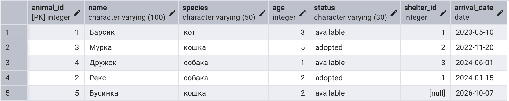

### Запрос 1.2
Вывести всю информацию о приютах.

```sql
select *
from shelters;
```
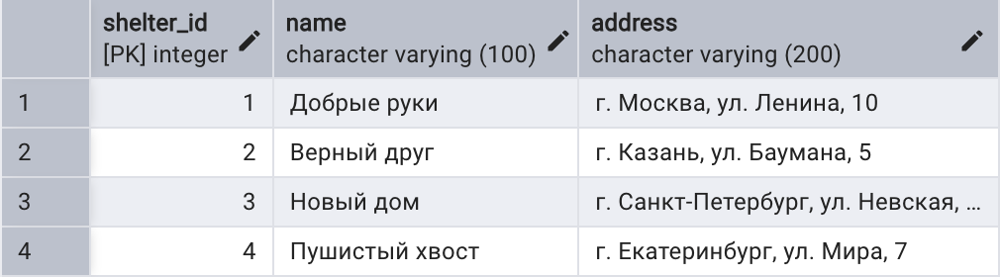

## 2. Выборка отдельных столбцов

### Запрос 2.1
Вывести только клички и виды животных.

```sql
select name, species
from animals;
```
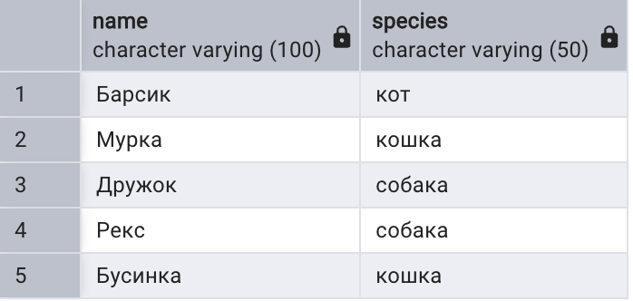

### Запрос 2.2
Вывести только имена и телефоны волонтёров.

```sql
select name, phone
from volunteers;
```
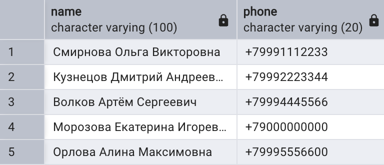

## 3. Присвоение новых имен столбцам при формировании выборки

### Запрос 3.1
Вывести клички и виды животных, переименовав столбцы на английский понятный вид.

```sql
select
    name as animal_name,
    species as animal_species
from animals;
```
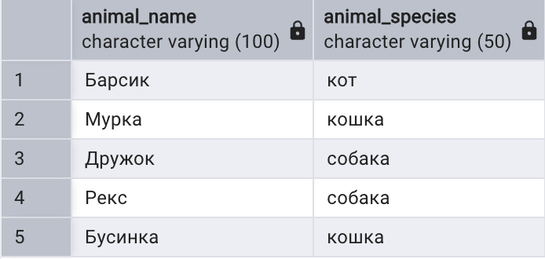

### Запрос 3.2
Вывести имена и почты посетителей с русскими названиями столбцов.

```sql
select
    name as "ФИО",
    email as "Электронная почта"
from visitors;
```
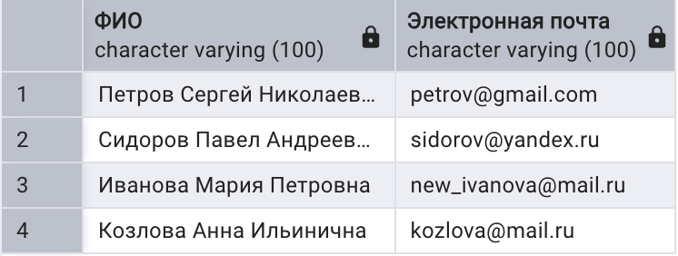

## 4. Выборка данных с созданием вычисляемого столбца

### Запрос 4.1
Вывести клички животных, их возраст и возраст в месяцах.

```sql
select
    name,
    age,
    age * 12 as age_in_months
from animals;
```
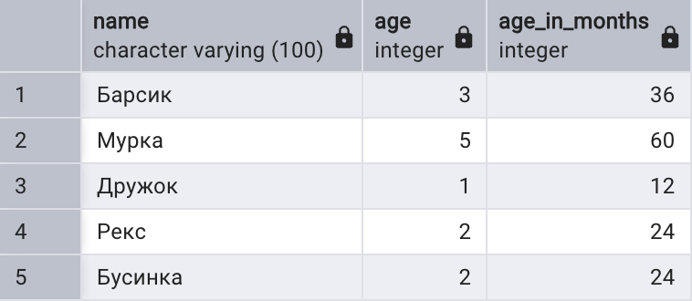

### Запрос 4.2
Вывести роль на смене и длительность смены (разница между временем окончания и начала).

```sql
select
    role,
    start_time,
    end_time,
    end_time - start_time as duration
from shifts;
```
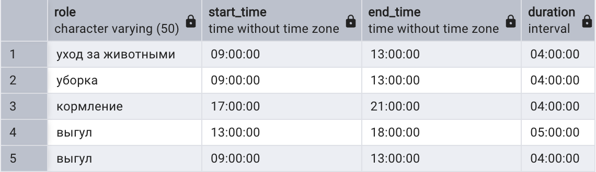

## 5. Вычисляемые столбцы, математические функции

### Запрос 5.1
Вывести клички животных, возраст и квадратный корень из возраста, округлённый до двух знаков.

```sql
select
    name,
    age,
    round(sqrt(age)::numeric, 2) as age_sqrt
from animals;
```
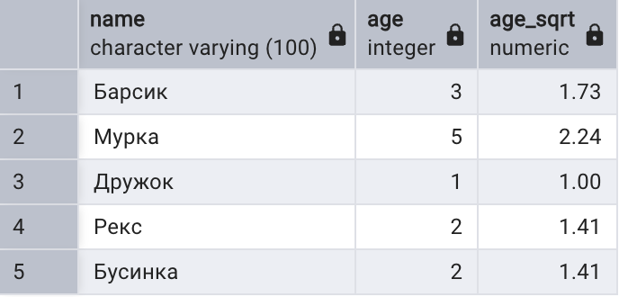

### Запрос 5.2
Вывести длительность каждой смены в часах.

```sql
select
    shifts_id,
    role,
    extract(epoch from (end_time - start_time)) / 3600 as hours
from shifts;
```
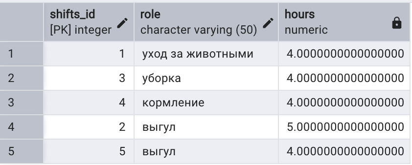

## 6. Вычисляемые столбцы, логические функции (CASE)

### Запрос 6.1
Вывести список животных (клички и возраст), а также добавить вычисляемый столбец с категорией: если возраст < 3 — «молодой», иначе «взрослый».

```sql
select
    name,
    age,
    case
        when age < 3 then 'молодой'
        else 'взрослый'
    end as age_category
from animals;
```
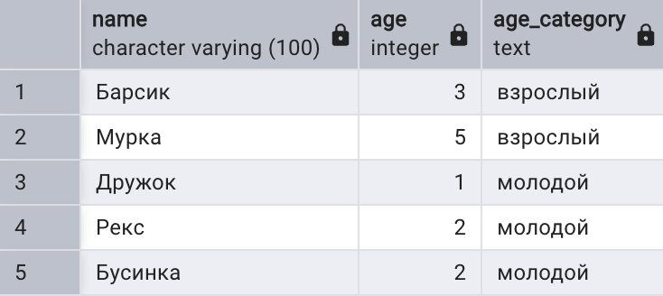

### Запрос 6.2
Вывести id заявки, id животного и понятный статус на русском языке (вместо английских pending, approved, rejected).

```sql
select
    application_id,
    animal_id,
    status as original_status,
    case
        when status = 'pending'  then 'В обработке'
        when status = 'approved' then 'Одобрено'
        when status = 'rejected' then 'Отклонено'
        else 'Неизвестно'
    end as russian_status
from adoption_applications;
```
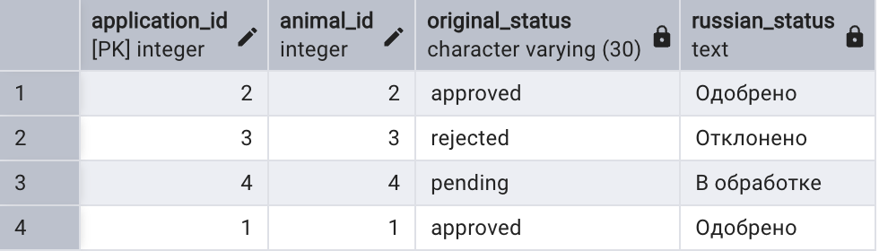

## 7. Выборка данных по условию

### Запрос 7.1
Вывести всех животных, которые доступны для усыновления.

```sql
select *
from animals
where status = 'available';
```
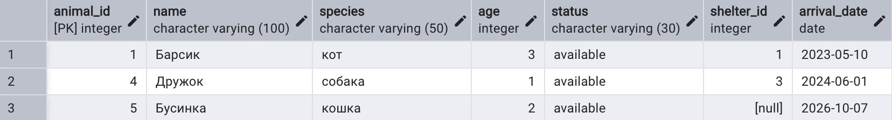

### Запрос 7.2
Вывести посетителей, зарегистрировавшихся в 2024 году.

```sql
select *
from visitors
where registration_year = 2024;
```
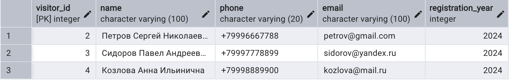

## 8. Выборка данных, логические операции (AND, OR, NOT)

### Запрос 8.1
Вывести собак, которые доступны для усыновления (условие AND).

```sql
select *
from animals
where species = 'собака'
  and status = 'available';
```
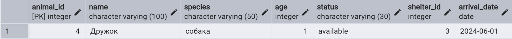

### Запрос 8.2
Вывести заявки, которые ещё в обработке или были отклонены (условие OR).

```sql
select *
from adoption_applications
where status = 'pending'
   or status = 'rejected';
```
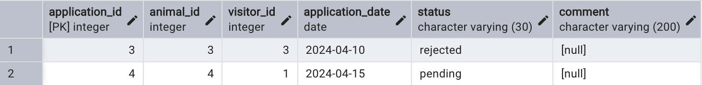

## 9. Выборка данных, операторы BETWEEN, IN

### Запрос 9.1
Вывести животных, возраст которых от 2 до 4 лет включительно (BETWEEN).

```sql
select name, species, age
from animals
where age between 2 and 4;
```
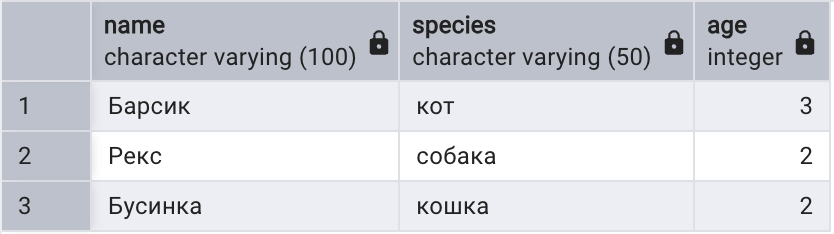

### Запрос 9.2
Вывести животных, которые находятся в приютах с id 1 и 3 (IN).

```sql
select name, species, shelter_id
from animals
where shelter_id in (1, 3);
```
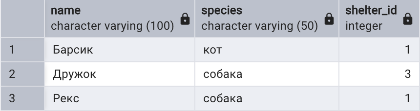

## 10. Выборка данных с сортировкой

### Запрос 10.1
Вывести всех животных, начиная с самых старших (сортировка по убыванию).

```sql
select name, age
from animals
order by age desc;
```
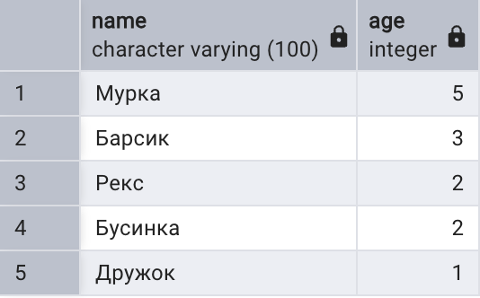

### Запрос 10.2
Вывести животных по дате поступления в приют, от самых давних; при одинаковой дате — по кличке.

```sql
select name, arrival_date
from animals
order by arrival_date asc, name asc;
```
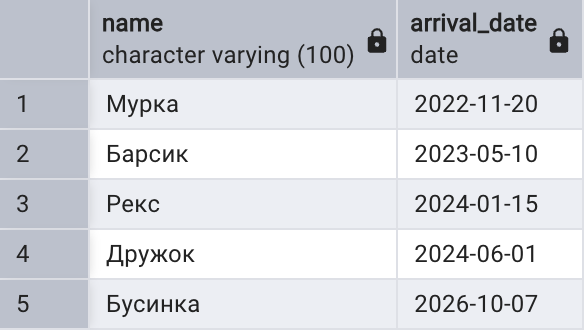

## 11. Выборка данных, оператор LIKE

### Запрос 11.1
Вывести посетителей, имя которых начинается на букву «И».

```sql
select name, email
from visitors
where name like 'И%';
```
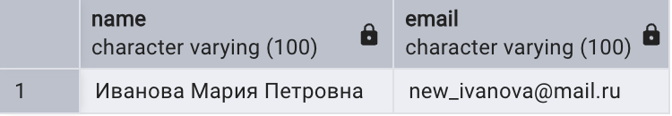

### Запрос 11.2
Вывести посетителей, у которых почта на домене mail.ru.

```sql
select name, email
from visitors
where email like '%@mail.ru';
```
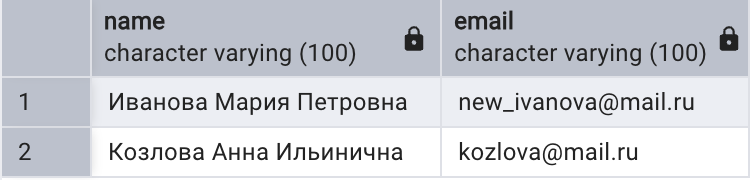

## 12. Выбор уникальных элементов столбца

### Запрос 12.1
Вывести все виды животных без повторений.

```sql
select distinct species
from animals;
```
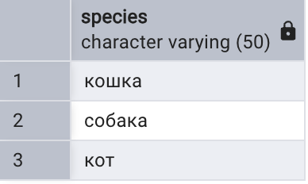

### Запрос 12.2
Вывести все статусы, которые встречаются в заявках, без повторений.

```sql
select distinct status
from adoption_applications;
```
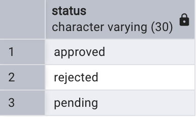

## 13. Выбор ограниченного количества возвращаемых строк

### Запрос 13.1
Вывести двух самых старых животных.

```sql
select name, age
from animals
order by age desc
limit 2;
```
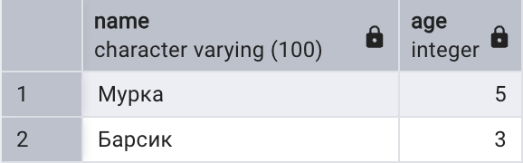

### Запрос 13.2
Вывести три последние поданные заявки.

```sql
select application_id, application_date, status
from adoption_applications
order by application_date desc
limit 3;
```
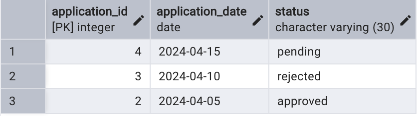

# Блок 2: JOIN

## 14. JOIN

### Запрос 14.1
Вывести кличку животного и название приюта, в котором оно находится.

```sql
select
    a.name as animal_name,
    s.name as shelter_name
from animals a
join shelters s on a.shelter_id = s.shelter_id;
```
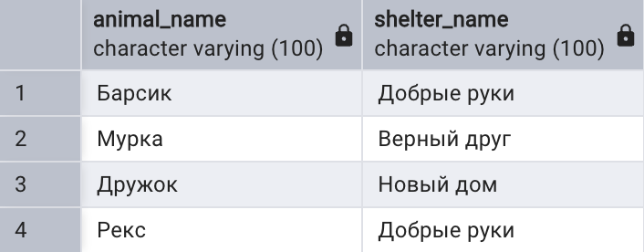

### Запрос 14.2
Вывести имя волонтёра, дату смены и роль на смене.

```sql
select
    v.name as volunteer_name,
    sh.date as shift_date,
    sh.role
from shifts sh
join volunteers v on sh.volunteer_id = v.volunteer_id;
```
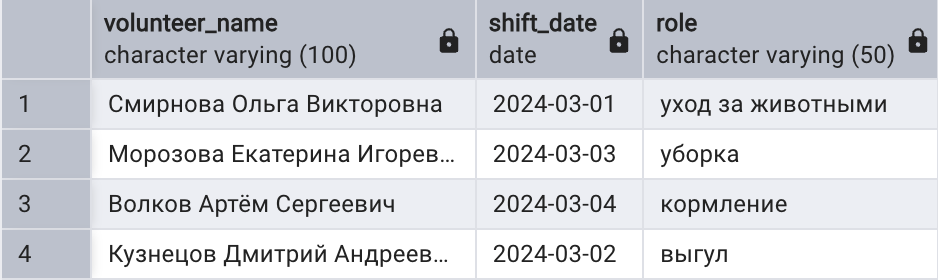

## 15. INNER JOIN

### Запрос 15.1
Вывести имя посетителя, который подал заявку, ID животного, на которое он претендует, и статус заявки.

```sql
select
    v.name as visitor_name,
    ap.animal_id,
    ap.status
from adoption_applications ap
inner join visitors v on ap.visitor_id = v.visitor_id;
```
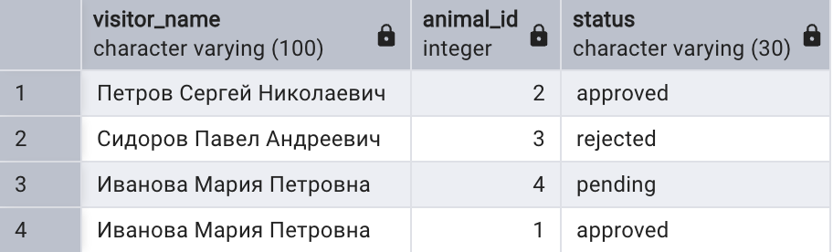

### Запрос 15.2
Вывести клички животных, на которых есть одобренные заявки.

```sql
select
    a.name as animal_name,
    ap.application_date
from animals a
inner join adoption_applications ap on a.animal_id = ap.animal_id
where ap.status = 'approved';
```
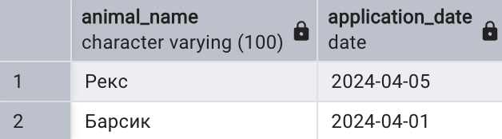

## 16. Внешнее соединение: LEFT и RIGHT OUTER JOIN

### LEFT OUTER JOIN

#### Запрос 16.1
Вывести все приюты и привязанных к ним животных. Если в приюте нет животных, вместо клички будет NULL.

```sql
select
    s.name as shelter_name,
    a.name as animal_name
from shelters s
left join animals a on s.shelter_id = a.shelter_id;
```
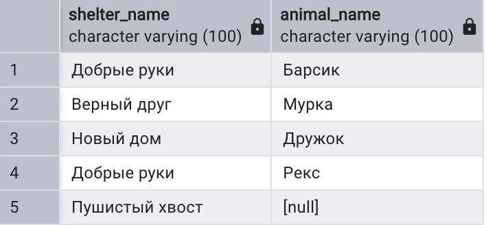

#### Запрос 16.2
Вывести всех животных и заявки на них. Если на животное нет заявок, статус будет NULL.

```sql
select
    a.name as animal_name,
    ap.status as application_status
from animals a
left join adoption_applications ap on a.animal_id = ap.animal_id;
```
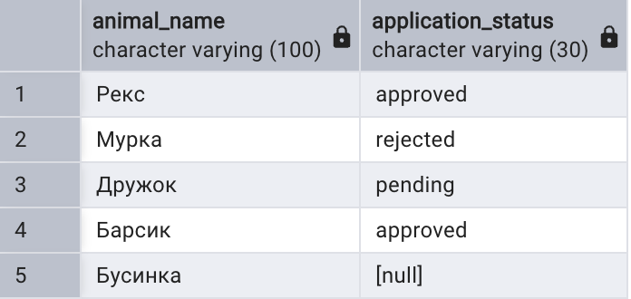

### RIGHT OUTER JOIN

#### Запрос 16.3
Вывести всех волонтёров и их смены. Если у волонтёра нет смен, дата и время будут NULL.

```sql
select
    v.name as volunteer_name,
    sh.date as shift_date,
    sh.start_time
from shifts sh
right join volunteers v on sh.volunteer_id = v.volunteer_id;
```
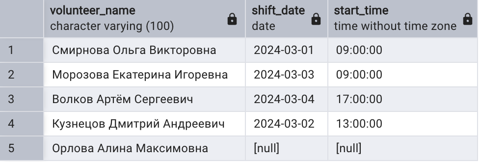

#### Запрос 16.4
Вывести всех животных и приюты так, чтобы таблица приютов (правая) была выведена полностью.

```sql
select
    a.name as animal_name,
    s.name as shelter_name
from animals a
right join shelters s on a.shelter_id = s.shelter_id;
```
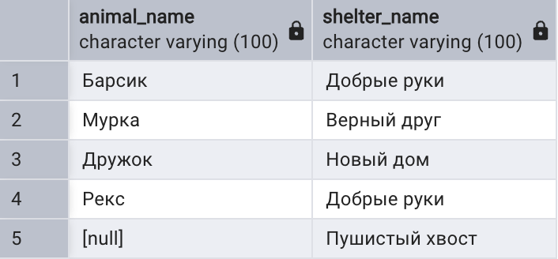

### FULL OUTER JOIN

#### Запрос 16.5
Связать приюты и координаторов через полное соединение: попадут и приюты без координатора, и координаторы без приюта.

```sql
select
    s.name as shelter_name,
    c.name as coordinator_name
from shelters s
full outer join coordinators c on s.shelter_id = c.shelter_id;
```
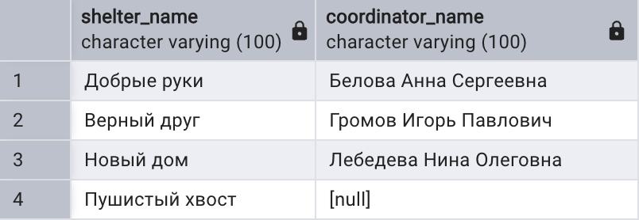

#### Запрос 16.6
Показать полное внешнее соединение волонтёров и смен.

```sql
select
    v.name as volunteer_name,
    sh.date as shift_date
from volunteers v
full outer join shifts sh on v.volunteer_id = sh.volunteer_id;
```
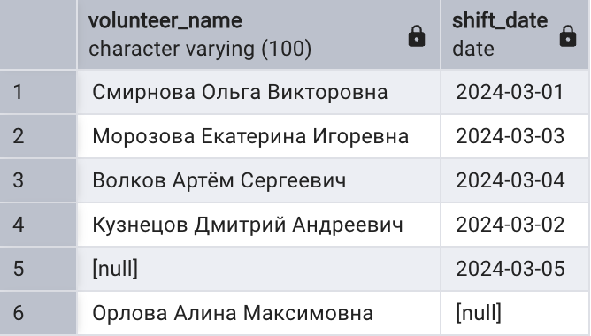

## 17. Перекрестное соединение CROSS JOIN

### Запрос 17.1
Получить все возможные комбинации приютов и ролей на смене.

```sql
select
    s.name as shelter_name,
    r.role_name
from shelters s
cross join (
    values ('выгул'), ('уборка'), ('кормление')
) as r(role_name);
```
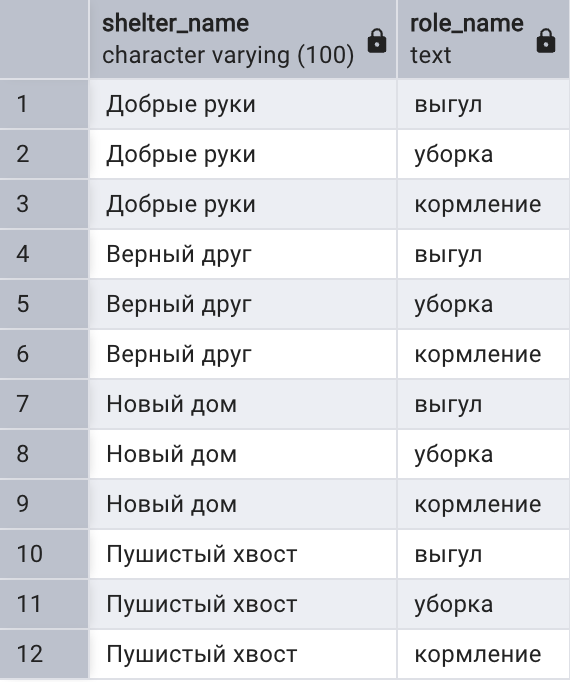

### Запрос 17.2
Получить все возможные комбинации животных и статусов заявок.

```sql
select
    a.name as animal_name,
    st.status
from animals a
cross join (
    values ('pending'), ('approved'), ('rejected')
) as st(status);
```
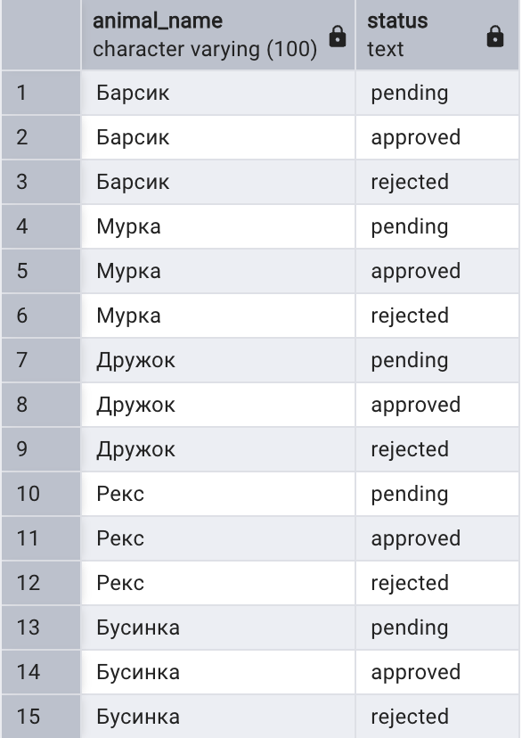

## 18. Запросы на выборку из нескольких таблиц

### Запрос 18.1
Вывести заявки с именем посетителя, кличкой животного и названием приюта, где это животное находится.

```sql
select
    v.name as visitor_name,
    a.name as animal_name,
    s.name as shelter_name,
    ap.status
from adoption_applications ap
join visitors v on ap.visitor_id = v.visitor_id
join animals a on ap.animal_id = a.animal_id
join shelters s on a.shelter_id = s.shelter_id;
```
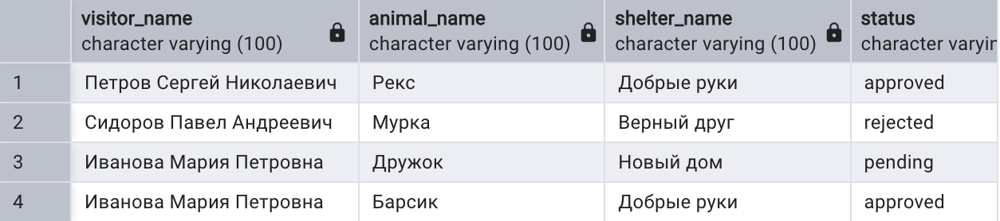

### Запрос 18.2
Вывести волонтёров, их координаторов и приюты, в которых эти координаторы работают.

```sql
select
    v.name as volunteer_name,
    c.name as coordinator_name,
    s.name as shelter_name
from volunteer_coordinators vc
join volunteers v on vc.volunteer_id = v.volunteer_id
join coordinators c on vc.coordinator_id = c.coordinator_id
join shelters s on c.shelter_id = s.shelter_id
order by v.name;
```
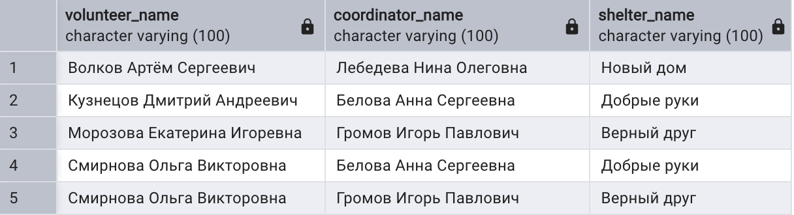