# HW5: агрегатные функции и группировка

# Блок 1: агрегатные функции

## 1. AVG

### Запрос 1.1
Вычислить средний возраст всех животных в приютах.

```sql
select
    round(avg(age), 2) as avg_age
from animals;
```
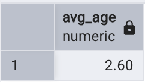

### Запрос 1.2
Вычислить среднюю длительность смены волонтёров.

```sql
select
    avg(end_time - start_time) as avg_shift_duration
from shifts;
```
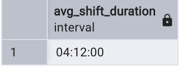

## 2. COUNT

### Запрос 2.1
Посчитать общее количество животных.

```sql
select
    count(*) as total_animals
from animals;
```
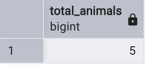

### Запрос 2.2
Посчитать, сколько разных видов животных живёт в приютах.

```sql
select
    count(distinct species) as species_count
from animals;
```
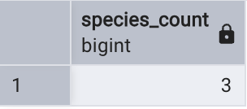

## 3. MIN и MAX

### Запрос 3.1
Найти возраст самого молодого и самого старого животного.

```sql
select
    min(age) as youngest_age,
    max(age) as oldest_age
from animals;
```


### Запрос 3.2
Найти даты первого и последнего поступления животных в приюты.

```sql
select
    min(arrival_date) as first_arrival,
    max(arrival_date) as last_arrival
from animals;
```
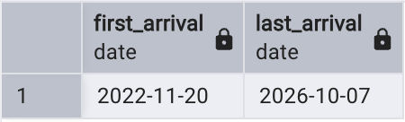

## 4. SUM

### Запрос 4.1
Посчитать суммарный возраст всех животных.

```sql
select
    sum(age) as total_age
from animals;
```
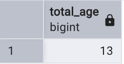

### Запрос 4.2
Посчитать общее время, отработанное волонтёрами по всем сменам.

```sql
select
    sum(end_time - start_time) as total_shift_time
from shifts;
```
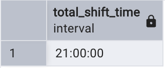

## 5. STRING_AGG

### Запрос 5.1
Вывести клички всех животных одной строкой через запятую.

```sql
select
    string_agg(name, ', ' order by name) as animal_names
from animals;
```


### Запрос 5.2
Вывести одной строкой все виды животных без повторений.

```sql
select
    string_agg(distinct species, ', ' order by species) as species_list
from animals;
```
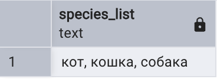

## 6. Комбинирование функций

### Запрос 6.1
Получить сводку по животным: количество, средний, минимальный и максимальный возраст.

```sql
select
    count(*)            as animals_total,
    round(avg(age), 2)  as avg_age,
    min(age)            as min_age,
    max(age)            as max_age
from animals;
```


### Запрос 6.2
Получить сводку по сменам: количество смен, общее отработанное время и список ролей.

```sql
select
    count(*)                               as shifts_count,
    sum(end_time - start_time)             as total_time,
    string_agg(role, ', ' order by role)   as roles
from shifts;
```
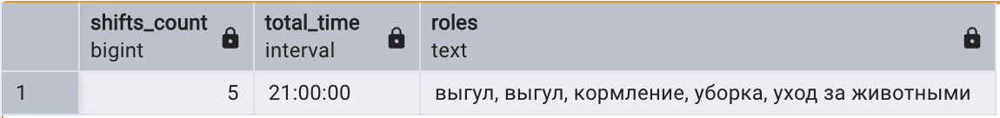

# Блок 2: группировка

## 7. GROUP BY

### Запрос 7.1
Посчитать, сколько животных каждого вида.

```sql
select
    species,
    count(*) as animals_count
from animals
group by species;
```
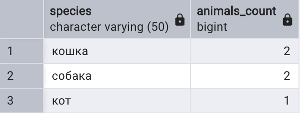

### Запрос 7.2
Посчитать количество животных в каждом приюте (включая приюты без животных).

```sql
select
    s.name as shelter_name,
    count(a.animal_id) as animals_count
from shelters s
left join animals a on s.shelter_id = a.shelter_id
group by s.shelter_id, s.name;
```
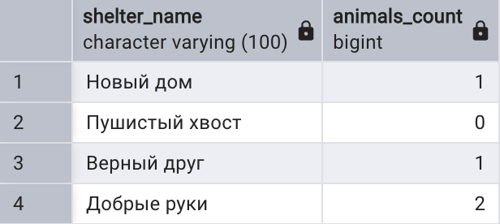

## 8. WHERE

### Запрос 8.1
Посчитать животных каждого вида, но только тех, которые доступны для усыновления. Условие `where` отбирает строки до группировки.

```sql
select
    species,
    count(*) as available_count
from animals
where status = 'available'
group by species;
```
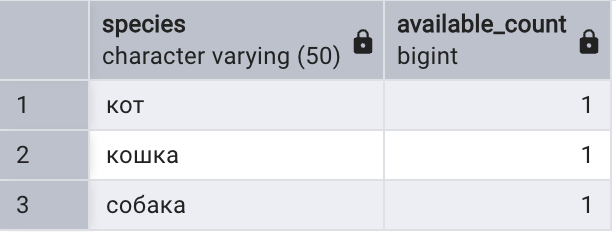

### Запрос 8.2
Посчитать заявки по статусам, но только поданные начиная с 5 апреля 2024 года.

```sql
select
    status,
    count(*) as applications_count
from adoption_applications
where application_date >= '2024-04-05'
group by status;
```
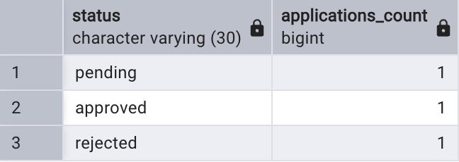

## 9. HAVING

### Запрос 9.1
Вывести виды животных, которых в приютах больше одного. Условие `having` отбирает группы после группировки.

```sql
select
    species,
    count(*) as animals_count
from animals
group by species
having count(*) > 1;
```
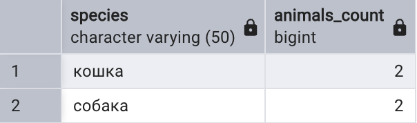

### Запрос 9.2
Вывести посетителей, которые подали больше одной заявки.

```sql
select
    v.name as visitor_name,
    count(*) as applications_count
from adoption_applications ap
join visitors v on ap.visitor_id = v.visitor_id
group by v.visitor_id, v.name
having count(*) > 1;
```
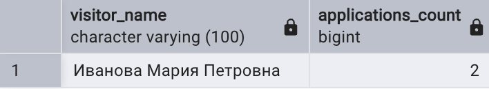

# Блок 3: GROUPING SETS, ROLLUP, CUBE

## 10. GROUPING SETS

### Запрос 10.1
Получить в одной выборке количество животных по видам, по статусам и общий итог.

```sql
select
    species,
    status,
    count(*) as animals_count
from animals
group by grouping sets (
    (species),
    (status),
    ()
);
```
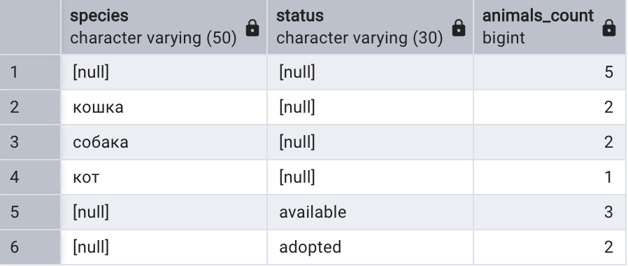

### Запрос 10.2
Получить в одной выборке количество животных по приютам и по видам.

```sql
select
    shelter_id,
    species,
    count(*) as animals_count
from animals
group by grouping sets (
    (shelter_id),
    (species)
);
```
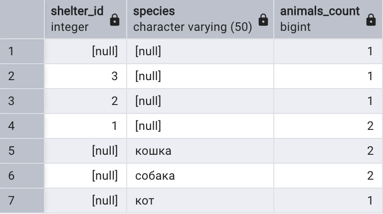

## 11. ROLLUP

### Запрос 11.1
Получить количество животных по приютам и видам, промежуточные итоги по каждому приюту и общий итог.

```sql
select
    shelter_id,
    species,
    count(*) as animals_count
from animals
group by rollup (shelter_id, species)
order by shelter_id, species;
```
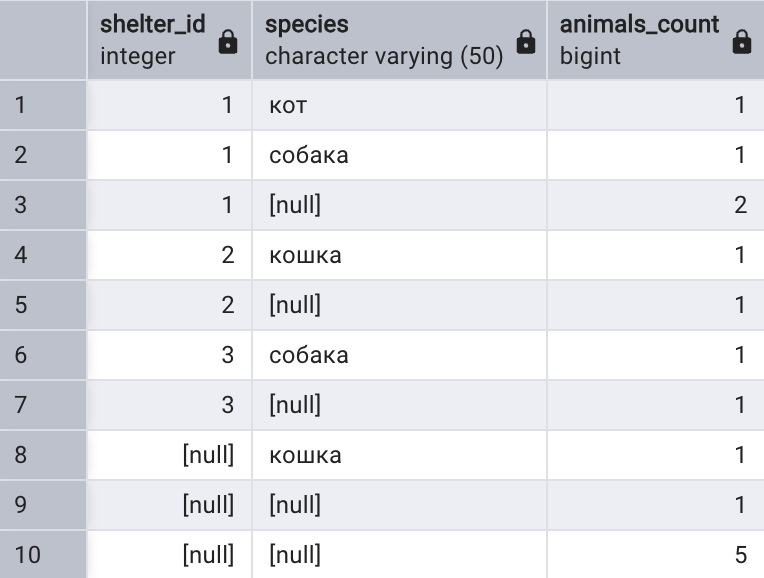

### Запрос 11.2
Получить средний возраст животных по видам и статусам с промежуточными итогами по видам и общим итогом.

```sql
select
    species,
    status,
    round(avg(age), 2) as avg_age
from animals
group by rollup (species, status)
order by species, status;
```
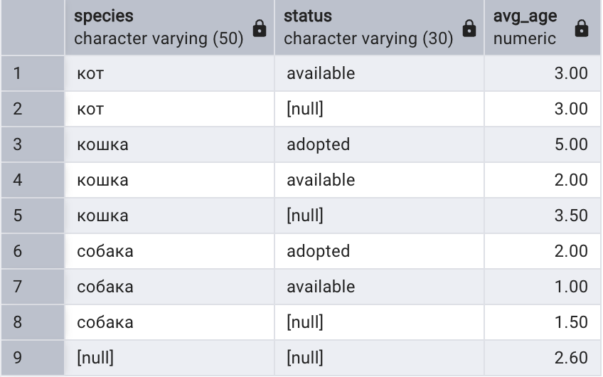

## 12. GROUPING SETS (эквивалент ROLLUP)

### Запрос 12.1
То же, что запрос 11.1, но записанное через `grouping sets`: `rollup (a, b)` равен наборам `(a, b)`, `(a)` и `()`.

```sql
select
    shelter_id,
    species,
    count(*) as animals_count
from animals
group by grouping sets (
    (shelter_id, species),
    (shelter_id),
    ()
)
order by shelter_id, species;
```
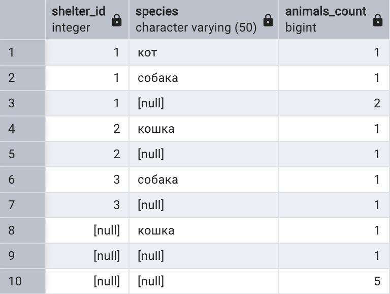

### Запрос 12.2
То же, что запрос 11.2, но записанное через `grouping sets`.

```sql
select
    species,
    status,
    round(avg(age), 2) as avg_age
from animals
group by grouping sets (
    (species, status),
    (species),
    ()
)
order by species, status;
```
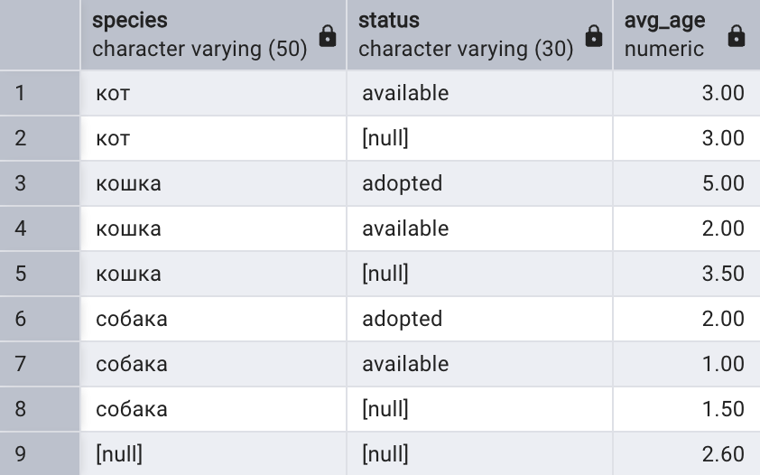

## 13. CUBE

### Запрос 13.1
Получить количество животных по всем комбинациям вида и статуса: по каждой паре, по видам, по статусам и общий итог.

```sql
select
    species,
    status,
    count(*) as animals_count
from animals
group by cube (species, status)
order by species, status;
```
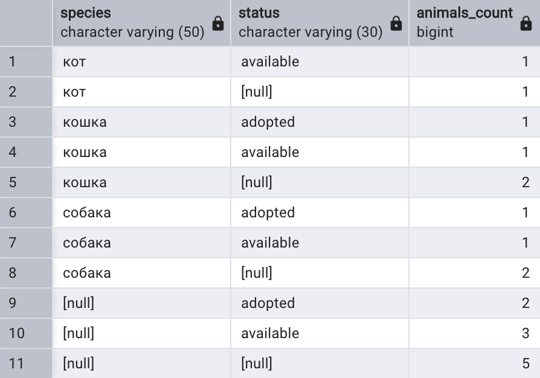

### Запрос 13.2
Получить суммарный возраст животных по всем комбинациям приюта и статуса.

```sql
select
    shelter_id,
    status,
    sum(age) as total_age
from animals
group by cube (shelter_id, status)
order by shelter_id, status;
```
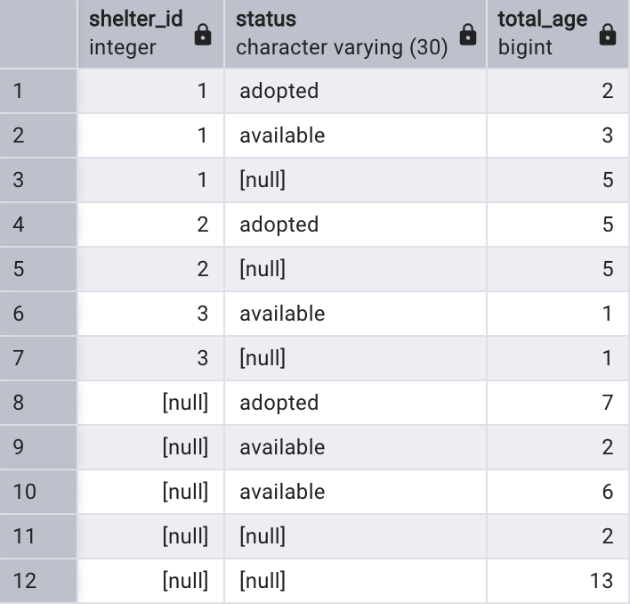

## 14. GROUPING SETS (эквивалент CUBE)

### Запрос 14.1
То же, что запрос 13.1, но записанное через `grouping sets`: `cube (a, b)` равен наборам `(a, b)`, `(a)`, `(b)` и `()`.

```sql
select
    species,
    status,
    count(*) as animals_count
from animals
group by grouping sets (
    (species, status),
    (species),
    (status),
    ()
)
order by species, status;
```
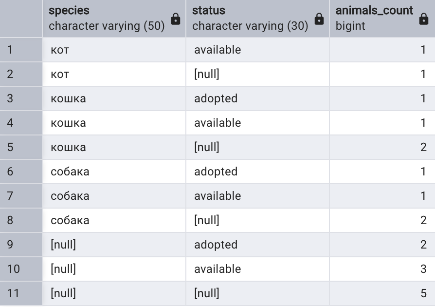

### Запрос 14.2
То же, что запрос 13.2, но записанное через `grouping sets`.

```sql
select
    shelter_id,
    status,
    sum(age) as total_age
from animals
group by grouping sets (
    (shelter_id, status),
    (shelter_id),
    (status),
    ()
)
order by shelter_id, status;
```
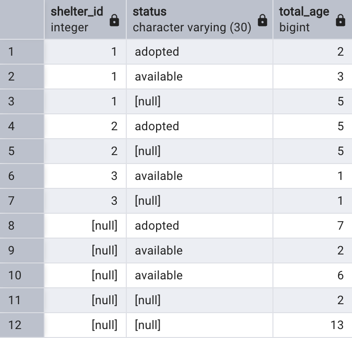

# Блок 4: полный запрос

## 15. SELECT, FROM, WHERE, GROUP BY, HAVING, ORDER BY

### Запрос 15.1
Для приютов вывести количество и средний возраст животных, поступивших с 2023 года. Оставить только приюты со средним возрастом не меньше 2 лет и отсортировать по количеству животных.

```sql
select
    s.name as shelter_name,
    count(*) as animals_count,
    round(avg(a.age), 2) as avg_age
from animals a
join shelters s on a.shelter_id = s.shelter_id
where a.arrival_date >= '2023-01-01'
group by s.name
having avg(a.age) >= 2
order by animals_count desc, s.name;
```
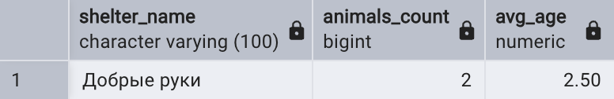

### Запрос 15.2
Для посетителей, подавших заявки в апреле 2024 года, вывести количество заявок и список статусов. Оставить только тех, у кого больше одной заявки.

```sql
select
    v.name as visitor_name,
    count(*) as applications_count,
    string_agg(ap.status, ', ' order by ap.status) as statuses
from adoption_applications ap
join visitors v on ap.visitor_id = v.visitor_id
where ap.application_date between '2024-04-01' and '2024-04-30'
group by v.name
having count(*) > 1
order by applications_count desc, v.name;
```
