# HW6: подзапросы

# Блок 1: некоррелированные подзапросы

## 1. Подзапрос в SELECT

### Запрос 1.1
Вывести клички и возраст животных, а также средний возраст всех животных. Скалярный подзапрос выполняется один раз, его результат подставляется в каждую строку

```sql
select
    name,
    age,
    (select round(avg(age), 2) from animals) as avg_age
from animals;
```
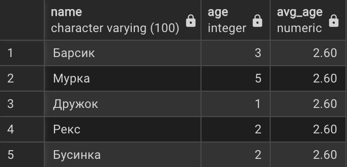

### Запрос 1.2
Вывести заявки на усыновление и общее количество заявок в системе

```sql
select
    application_id,
    status,
    (select count(*) from adoption_applications) as total_applications
from adoption_applications;
```
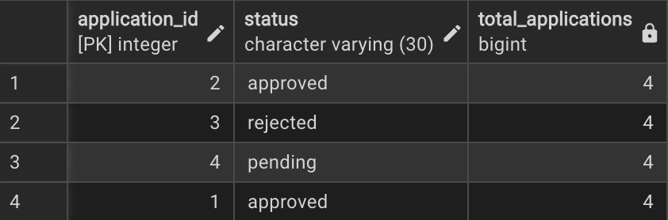

## 2. Подзапрос в FROM

### Запрос 2.1
Вывести виды животных, средний возраст которых больше 2 лет. Подзапрос в `from` работает как временная таблица, к которой применяется `where`

```sql
select
    species,
    avg_age
from (
    select
        species,
        round(avg(age), 2) as avg_age
    from animals
    group by species
) as sub
where avg_age > 2;
```
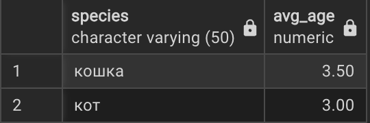

### Запрос 2.2
Вывести волонтёров, у которых суммарное время смен больше 4 часов

```sql
select
    v.name as volunteer_name,
    t.total_time
from volunteers v
join (
    select
        volunteer_id,
        sum(end_time - start_time) as total_time
    from shifts
    group by volunteer_id
) as t on v.volunteer_id = t.volunteer_id
where t.total_time > interval '4 hours';
```
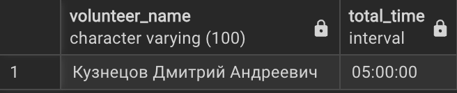

## 3. Подзапрос в WHERE

### Запрос 3.1
Вывести животных, возраст которых больше среднего. Подзапрос возвращает одно значение, поэтому его можно сравнивать через `>`

```sql
select
    name,
    species,
    age
from animals
where age > (select avg(age) from animals);
```
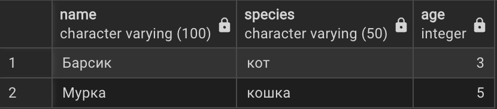

### Запрос 3.2
Вывести самую длинную смену (если таких несколько, то все)

```sql
select
    shifts_id,
    role,
    start_time,
    end_time
from shifts
where end_time - start_time = (
    select max(end_time - start_time)
    from shifts
);
```
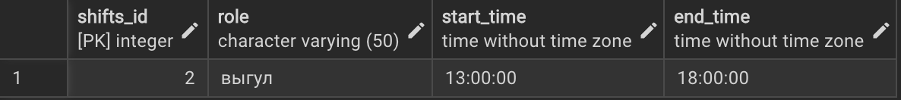

## 4. Подзапрос в HAVING

### Запрос 4.1
Вывести виды, количество животных которых больше среднего количества животных на один вид. Подзапрос в `having` сравнивается с результатом агрегатной функции по группе

```sql
select
    species,
    count(*) as animals_count
from animals
group by species
having count(*) > (
    select count(*)::numeric / count(distinct species)
    from animals
);
```
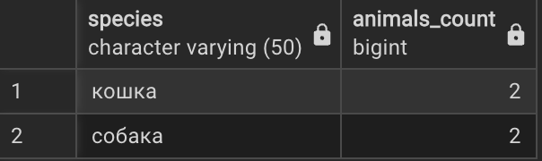

### Запрос 4.2
Вывести приюты, в которых средний возраст животных выше среднего возраста по всем приютам

```sql
select
    s.name as shelter_name,
    round(avg(a.age), 2) as avg_age
from animals a
join shelters s on a.shelter_id = s.shelter_id
group by s.shelter_id, s.name
having avg(a.age) > (select avg(age) from animals);
```
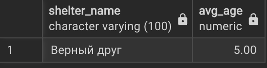

## 5. Подзапрос и оператор ALL

### Запрос 5.1
Вывести животных, которые старше всех животных из приюта с id 1. Условие истинно, только если сравнение выполняется со всеми значениями подзапроса

```sql
select
    name,
    age
from animals
where age > all (
    select age
    from animals
    where shelter_id = 1
);
```
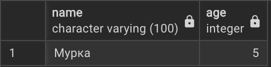

### Запрос 5.2
Вывести приюты, в которых нет ни одного усыновлённого животного

```sql
select
    name as shelter_name
from shelters
where shelter_id <> all (
    select shelter_id
    from animals
    where status = 'adopted'
);
```
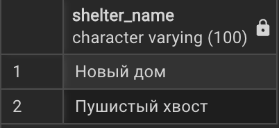

## 6. Подзапрос и оператор IN

### Запрос 6.1
Вывести посетителей, у которых есть заявки в статусе «в обработке». Оператор `in` проверяет, входит ли значение в набор, возвращённый подзапросом

```sql
select
    name,
    email
from visitors
where visitor_id in (
    select visitor_id
    from adoption_applications
    where status = 'pending'
);
```
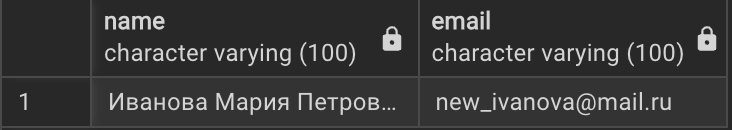

### Запрос 6.2
Вывести приюты, в которых есть животные, доступные для усыновления

```sql
select
    name as shelter_name,
    address
from shelters
where shelter_id in (
    select shelter_id
    from animals
    where status = 'available'
);
```
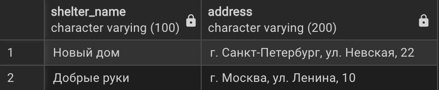

## 7. Подзапрос и оператор ANY

### Запрос 7.1
Вывести посетителей, у которых есть хотя бы одна одобренная заявка. Условие истинно, если сравнение верно хотя бы с одним значением подзапроса

```sql
select
    name,
    email
from visitors
where visitor_id = any (
    select visitor_id
    from adoption_applications
    where status = 'approved'
);
```
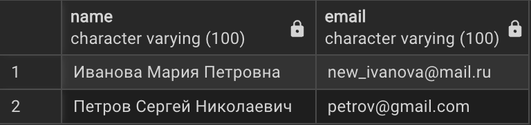

### Запрос 7.2
Вывести животных, которые старше хотя бы одного кота

```sql
select
    name,
    species,
    age
from animals
where age > any (
    select age
    from animals
    where species = 'кот'
);
```
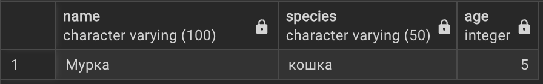

## 8. Подзапрос с EXISTS и NOT EXISTS

### Запрос 8.1
Вывести приюты, в которых есть животные с одобренной заявкой на усыновление. Оператор `exists` проверяет только наличие строк, поэтому в подзапросе достаточно `select 1`

```sql
select
    s.name as shelter_name
from shelters s
where exists (
    select 1
    from animals a
    join adoption_applications ap on ap.animal_id = a.animal_id
    where a.shelter_id = s.shelter_id
      and ap.status = 'approved'
);
```
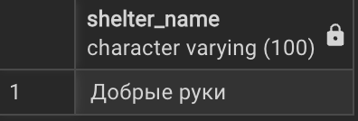

### Запрос 8.2
Вывести посетителей, у которых нет ни одной одобренной заявки

```sql
select
    v.name as visitor_name
from visitors v
where not exists (
    select 1
    from adoption_applications ap
    where ap.visitor_id = v.visitor_id
      and ap.status = 'approved'
);
```
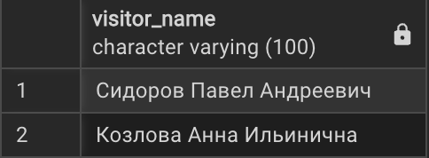

## 9. Сравнение по нескольким столбцам

### Запрос 9.1
Вывести животных, у которых пара (вид, статус) такая же, как у какого-либо животного от 3 лет и старше

```sql
select
    name,
    species,
    status,
    age
from animals
where (species, status) in (
    select species, status
    from animals
    where age >= 3
);
```
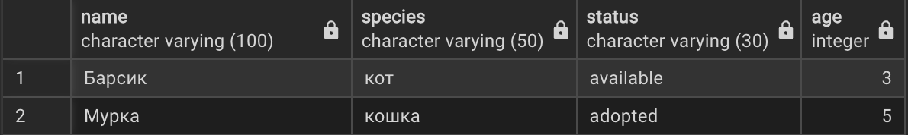

### Запрос 9.2
Вывести самое старое животное в каждом приюте: пара (приют, возраст) должна совпасть с парой из подзапроса

```sql
select
    name,
    shelter_id,
    age
from animals
where (shelter_id, age) in (
    select shelter_id, max(age)
    from animals
    group by shelter_id
);
```
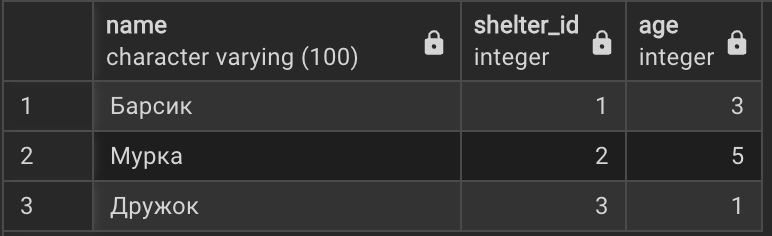

# Блок 2: коррелированные подзапросы

## 10. Коррелированные подзапросы

Коррелированный подзапрос ссылается на столбцы внешнего запроса и выполняется для каждой строки внешнего запроса

### Запрос 10.1
Вывести для каждого приюта количество животных в нём

```sql
select
    s.name as shelter_name,
    (
        select count(*)
        from animals a
        where a.shelter_id = s.shelter_id
    ) as animals_count
from shelters s;
```
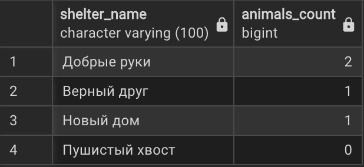

### Запрос 10.2
Вывести животных, возраст которых больше среднего возраста животных в их собственном приюте

```sql
select
    a.name,
    a.age,
    a.shelter_id
from animals a
where a.age > (
    select avg(a2.age)
    from animals a2
    where a2.shelter_id = a.shelter_id
);
```
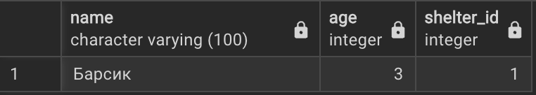

### Запрос 10.3
Вывести для каждого посетителя дату его последней заявки

```sql
select
    v.name as visitor_name,
    (
        select max(ap.application_date)
        from adoption_applications ap
        where ap.visitor_id = v.visitor_id
    ) as last_application_date
from visitors v;
```
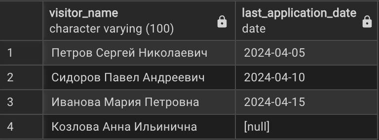

### Запрос 10.4
Вывести для каждого волонтёра количество координаторов, с которыми он работает

```sql
select
    v.name as volunteer_name,
    (
        select count(*)
        from volunteer_coordinators vc
        where vc.volunteer_id = v.volunteer_id
    ) as coordinators_count
from volunteers v
order by v.name;
```
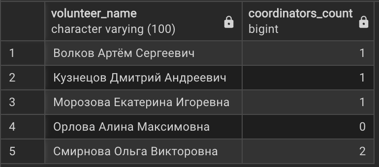

### Запрос 10.5
Вывести приюты, в которых больше одного животного. Такой запрос выполняет подзапрос для каждого приюта, поэтому на больших данных его лучше заменить на `join` с `group by` и `having`

```sql
select
    s.name as shelter_name
from shelters s
where (
    select count(*)
    from animals a
    where a.shelter_id = s.shelter_id
) > 1;
```
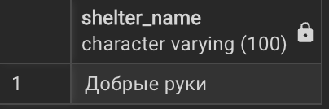