# HW6: CTE, оконные функции

# Блок 1: CTE и объединение запросов

## 1.CTE 

### Запрос 1.1
Вывести по каждому виду количество животных, доступных для усыновления, и их средний возраст. Сначала в CTE отбираются только доступные животные, затем по ним считается статистика

```sql
with available_animals as (
    select 
        animal_id, 
        name, 
        species, 
        age, 
        shelter_id 
    from animals where status = 'available'
)
select 
    species, 
    count(*) as animals_count, 
    round(avg(age), 2) as avg_age 
from available_animals 
group by species
order by species;
                                                                         group by species order by species;
```
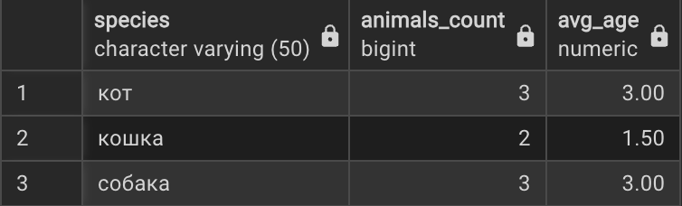

### Запрос 1.2
Вывести для каждого приюта количество животных, их средний возраст и количество заявок на усыновление. Два CTE перечисляются через запятую, затем соединяются с таблицей приютов

```sql
with animals_stat as (
    select 
        shelter_id, 
        count(*) as animals_count, 
        round(avg(age), 2) as avg_age 
    from animals group by shelter_id ),
applications_stat as (
    select 
        a.shelter_id, 
        count(*) as applications_count 
    from adoption_applications ap 
        join animals a on a.animal_id = ap.animal_id 
    group by a.shelter_id
)
select 
    s.name as shelter_name, 
    ast.animals_count, 
    ast.avg_age, 
    coalesce(aps.applications_count, 0) as applications_count
from shelters s 
    join animals_stat ast on ast.shelter_id = s.shelter_id 
    left join applications_stat aps on aps.shelter_id = s.shelter_id 
order by s.shelter_id;
```
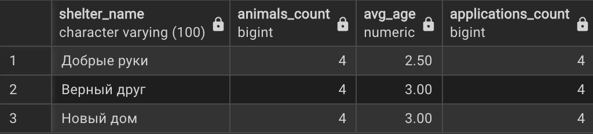

### Запрос 1.3
Вывести календарь с 1 по 15 марта 2024 и количество смен в каждый день, включая дни без смен. Рекурсивное CTE состоит из начального набора (первый день) и рекурсивной части, которая прибавляет по одному дню, пока не дойдёт до конца периода

```sql
with recursive calendar(work_date) as (
    select date '2024-03-01'
    union all
    select work_date + 1
    from calendar
    where work_date < date '2024-03-15'
)
select
    c.work_date,
    count(sh.shifts_id) as shifts_count
from calendar c left join shifts sh on sh.date = c.work_date 
group by c.work_date
order by c.work_date;
```
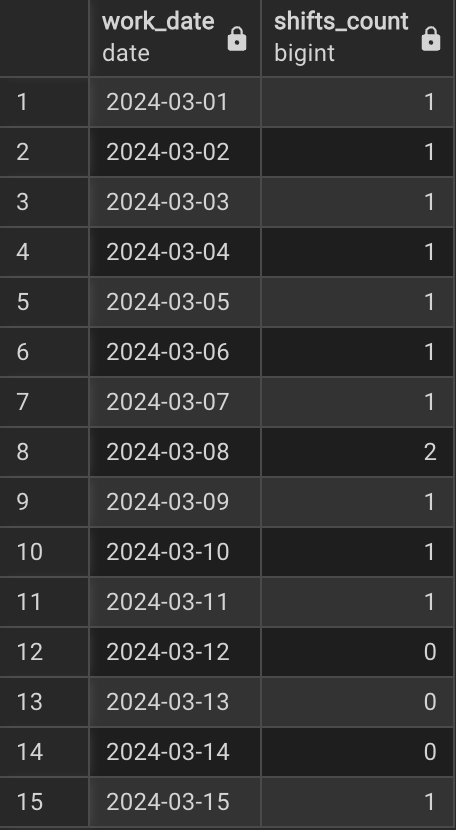

## 2. UNION

### Запрос 2.1
Вывести единый список контактов: волонтёры и посетители в одной таблице. Количество и типы столбцов в обоих запросах совпадают. `union` убирает повторяющиеся строки, а `union all` их оставил бы

```sql
select
    name, phone, 'волонтёр' as person_type
from volunteers
union
select name, phone, 'посетитель'
from visitors
order by person_type, name;
```
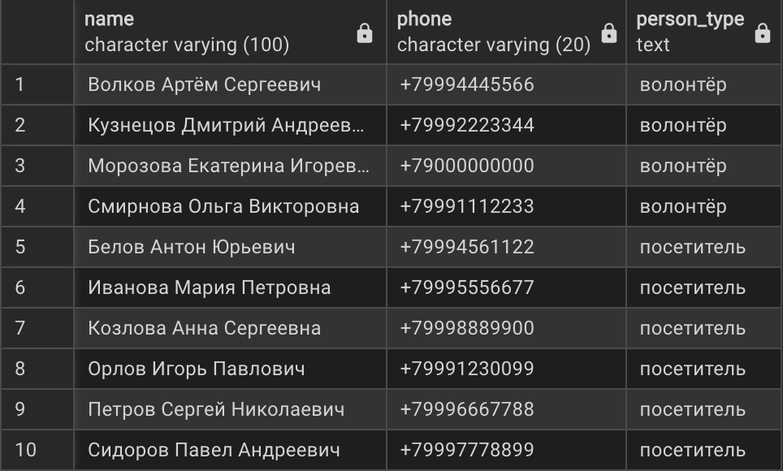

## 3. INTERSECT

### Запрос 3.1
Вывести посетителей, у которых есть и одобренные, и отклонённые заявки. `intersect` оставляет только те строки первого запроса, которые есть и во втором

```sql
select
    v.name as visitor_name 
from visitors v 
    join adoption_applications ap on ap.visitor_id = v.visitor_id
where ap.status = 'approved'
intersect
select
    v.name
from visitors v
    join adoption_applications ap on ap.visitor_id = v.visitor_id
where ap.status = 'rejected';
```
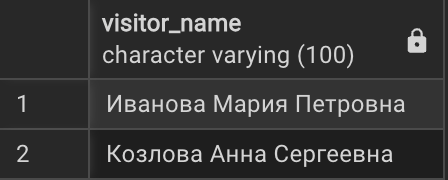

## 4. EXCEPT

### Запрос 4.1
Вывести посетителей, которые зарегистрировались, но не подали ни одной заявки. `except` оставляет строки первого запроса, которых нет во втором

```sql
select
    visitor_id,
    name
from visitors
except
select
    v.visitor_id,
    v.name
from visitors v join adoption_applications ap on ap.visitor_id = v.visitor_id;
```


# Блок 2: оконные функции

Оконная функция в отличие от `group by` не схлопывает строки, а добавляет к каждой строке новый вычисляемый столбец.

## 5. PARTITION BY

### Запрос 5.1
Вывести каждое животное и количество животных в его приюте. Окно разбито на партиции по приюту, поэтому внутри одного приюта значение одинаковое

```sql
select
    a.name,
    a.species,
    s.name as shelter_name,
    count(*) over (partition by a.shelter_id) as animals_in_shelter
from animals a
    join shelters s on s.shelter_id = a.shelter_id
order by a.shelter_id, a.animal_id;
```
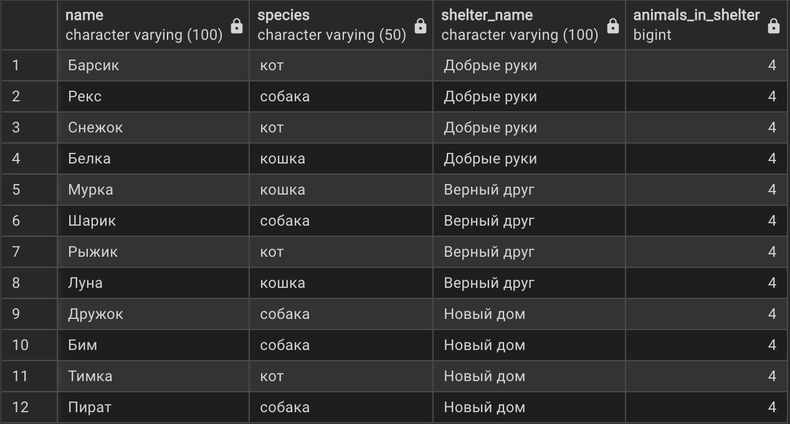

### Запрос 5.2
Вывести каждое животное, средний возраст его вида и разницу между возрастом животного и средним по виду

```sql
select
    name,
    species,
    age,
    round(avg(age) over (partition by species), 2) as avg_age_species,
    round(age - avg(age) over (partition by species), 2) as diff_from_avg
from animals
order by species, age, animal_id;
```
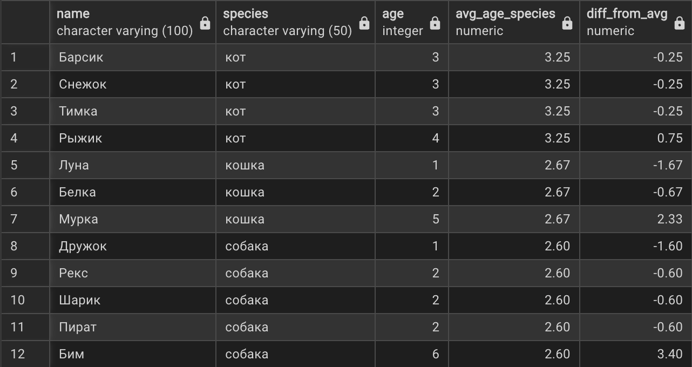

## 6. PARTITION BY + ORDER BY

С `order by` внутри `over` и без явного `rows`/`range` окно по умолчанию идёт от начала партиции до текущей строки, поэтому агрегаты считаются нарастающим итогом.

### Запрос 6.1
Вывести для каждого волонтёра смены в хронологическом порядке и накопленное время работы

```sql
select
    v.name as volunteer_name,
    sh.date,
    sh.role,
    sum(sh.end_time - sh.start_time) over (
        partition by sh.volunteer_id
        order by sh.date, sh.shifts_id
    ) as cumulative_time
from shifts sh
    join volunteers v on v.volunteer_id = sh.volunteer_id
order by v.name, sh.date, sh.shifts_id;
```
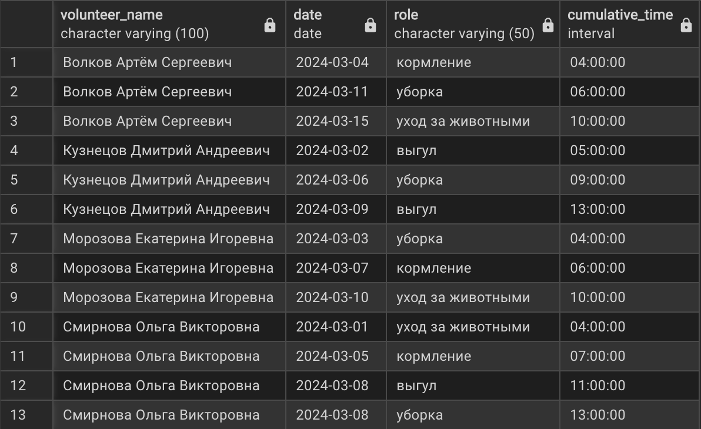

### Запрос 6.2
Вывести животных и сколько животных этого вида поступило в приюты к моменту их поступления (включая само животное)

```sql
select
    name,
    species,
    arrival_date,
    count(*) over (
        partition by species
        order by arrival_date, animal_id
    ) as arrived_total
from animals
order by species, arrival_date, animal_id;
```
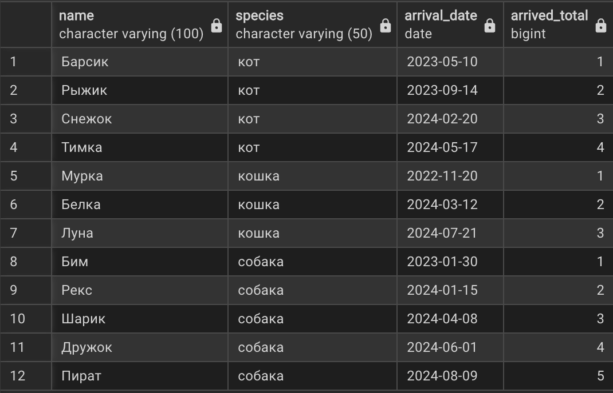

## 7. ROWS

`rows` задаёт границы окна по физическому положению строк относительно текущей.

### Запрос 7.1
Вывести скользящий средний возраст по трём последним поступившим животным в каждом приюте (текущее и два предыдущих)

```sql
select
    name,
    shelter_id,
    arrival_date,
    age,
    round(avg(age) over (
        partition by shelter_id
        order by arrival_date, animal_id
        rows between 2 preceding and current row
    ), 2) as moving_avg_age
from animals
order by shelter_id, arrival_date, animal_id;
```
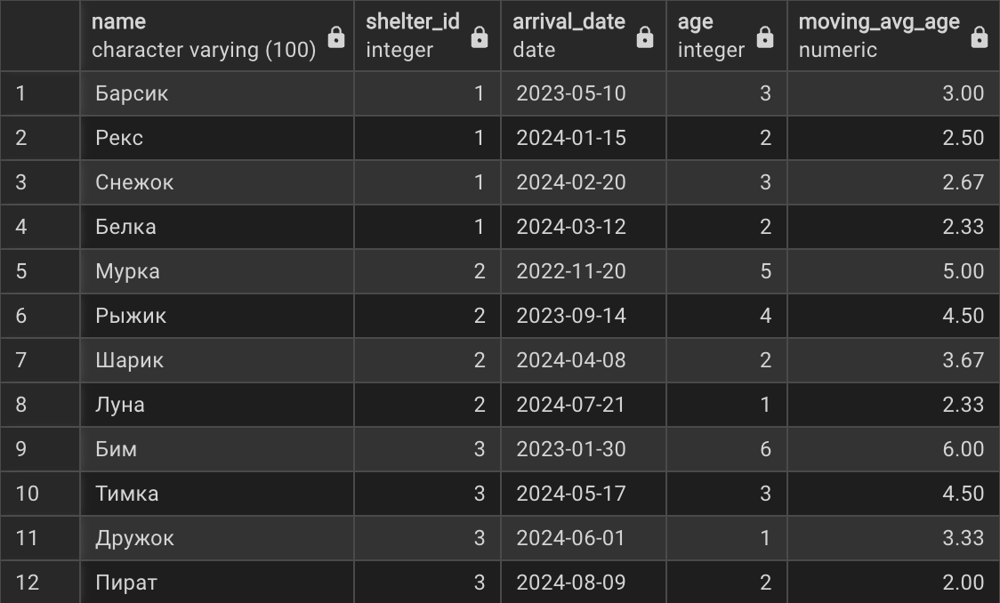

### Запрос 7.2
Вывести смены и сколько рабочего времени осталось отработать, начиная с текущей смены и до конца графика

```sql
select
    shifts_id,
    date,
    role,
    end_time - start_time as shift_duration,
    sum(end_time - start_time) over (
        order by date, shifts_id
        rows between current row and unbounded following
    ) as time_left
from shifts
order by date, shifts_id;
```
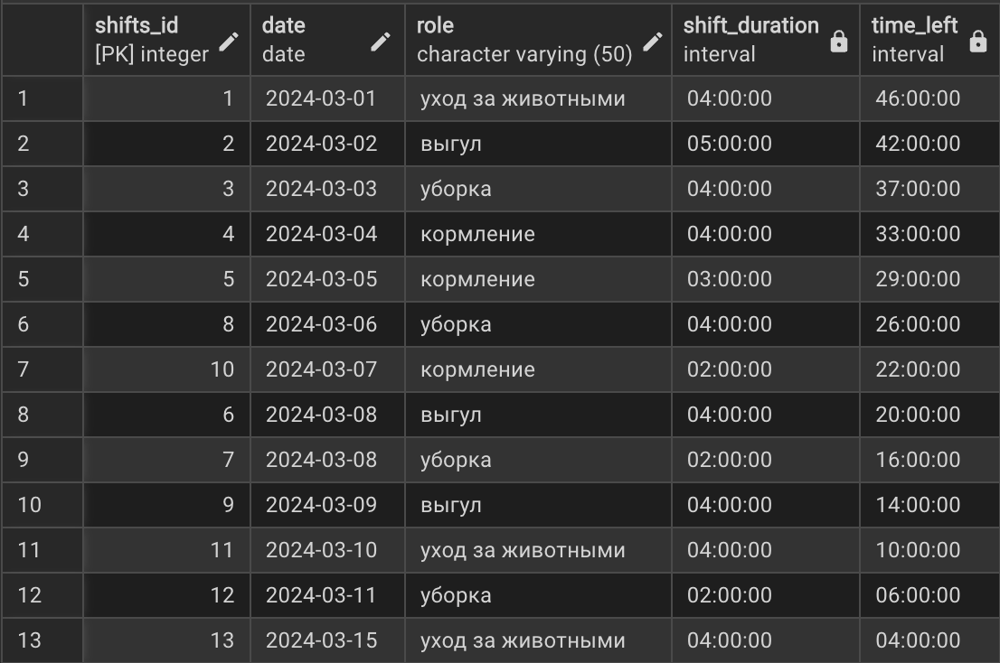

## 8. RANGE

`range` задаёт границы окна по значениям столбца из `order by`, поэтому строки с одинаковым значением (пиры) попадают в окно все вместе.

### Запрос 8.1
Вывести для каждого животного, сколько животных в его приюте имеют такой же возраст или на 1 год младше (включая само животное)

```sql
select
    name,
    shelter_id,
    age,
    count(*) over (
        partition by shelter_id
        order by age
        range between 1 preceding and current row
    ) as similar_age_count
from animals
order by shelter_id, age, animal_id;
```
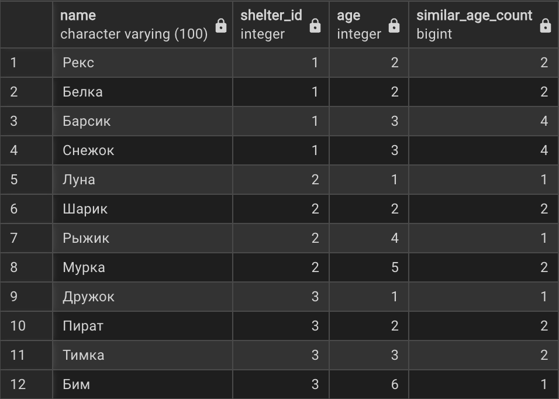

### Запрос 8.2
Вывести заявки и количество заявок, поданных за последние 30 дней до даты текущей заявки (включая её саму). У заявок 6 и 7 одна дата, поэтому значение у них одинаковое: `range` смотрит на значения, а не на позицию строки

```sql
select
    application_id,
    application_date,
    status,
    count(*) over (
        order by application_date
        range between interval '30 days' preceding and current row
    ) as applications_last_30_days
from adoption_applications
order by application_date, application_id;
```
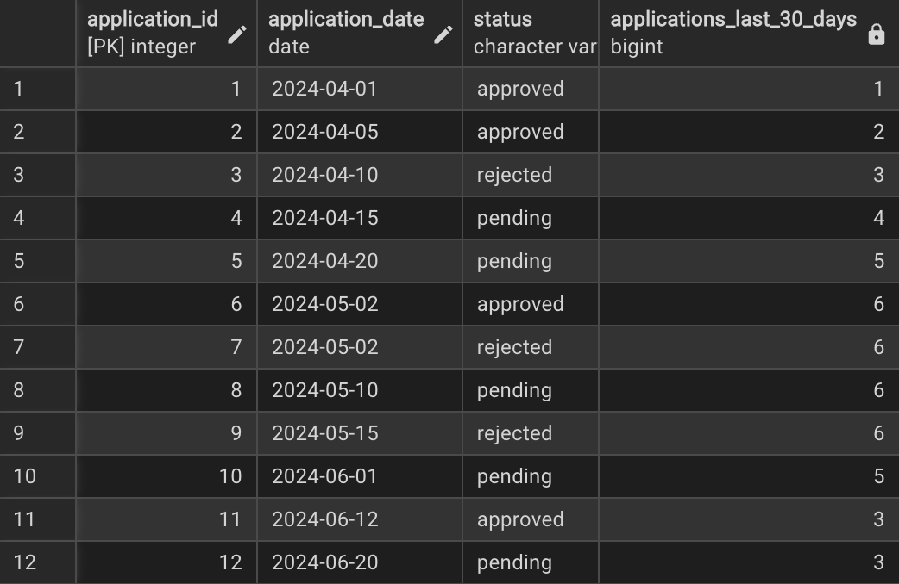

## 9. Ранжирующие функции

### Запрос 9.1
`row_number`: пронумеровать животных в каждом приюте по порядку поступления

```sql
select
    name,
    shelter_id,
    arrival_date,
    row_number() over (
        partition by shelter_id
        order by arrival_date, animal_id
    ) as arrival_number
from animals
order by shelter_id, arrival_number;
```
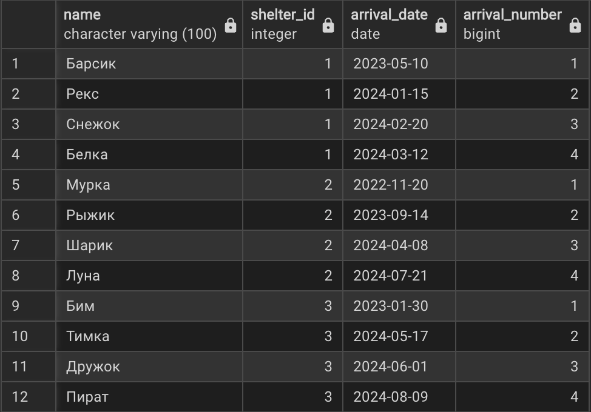

### Запрос 9.2
`rank`: проранжировать животных каждого приюта от старших к младшим. Одинаковый возраст даёт одинаковый ранг, а следующий ранг пропускается (1, 1, 3, 3)

```sql
select
    name,
    shelter_id,
    age,
    rank() over (
        partition by shelter_id
        order by age desc
    ) as age_rank
from animals
order by shelter_id, age_rank, animal_id;
```
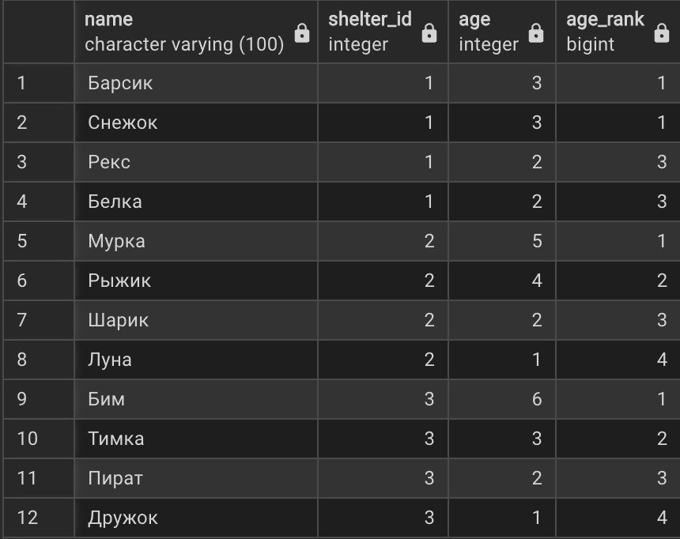

### Запрос 9.3
`dense_rank`: тот же рейтинг, но ранги идут подряд без пропусков (1, 1, 2, 2)

```sql
select
    name,
    shelter_id,
    age,
    dense_rank() over (
        partition by shelter_id
        order by age desc
    ) as age_dense_rank
from animals
order by shelter_id, age_dense_rank, animal_id;
```
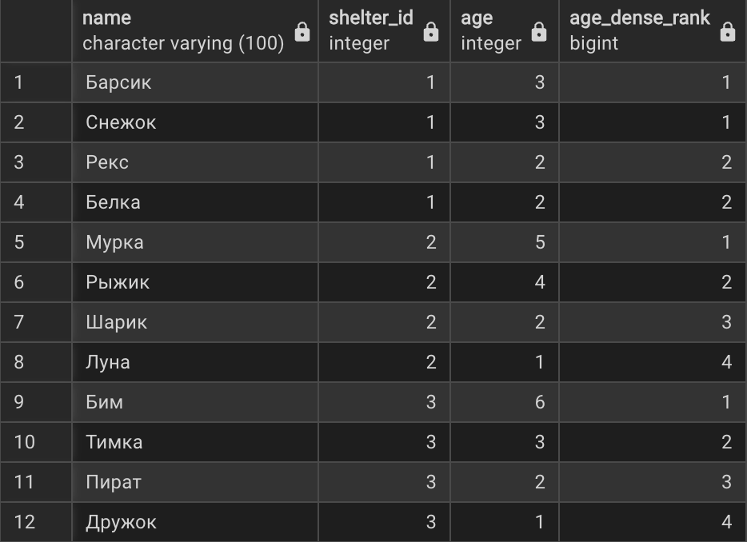

## 10. Функции смещения

### Запрос 10.1
`lag`: для каждой заявки вывести дату предыдущей заявки того же посетителя и сколько дней прошло между ними. У первой заявки посетителя предыдущей нет, поэтому будет `null`

```sql
select
    visitor_id,
    application_id,
    application_date,
    lag(application_date) over (
        partition by visitor_id
        order by application_date, application_id
    ) as prev_application_date,
    application_date - lag(application_date) over (
        partition by visitor_id
        order by application_date, application_id
    ) as days_since_prev
from adoption_applications
order by visitor_id, application_date, application_id;
```
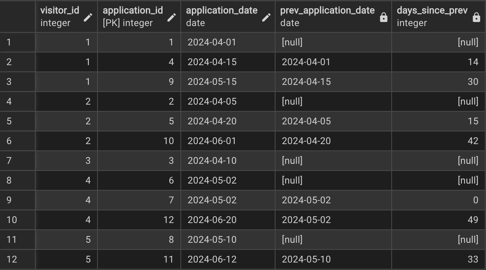

### Запрос 10.2
`lead`: для каждой смены волонтёра вывести дату и роль его следующей смены. Третий аргумент задаёт значение вместо `null`, когда следующей смены нет

```sql
select
    v.name as volunteer_name,
    sh.date,
    sh.role,
    lead(sh.date) over (
        partition by sh.volunteer_id
        order by sh.date, sh.shifts_id
    ) as next_shift_date,
    lead(sh.role, 1, 'смен больше нет') over (
        partition by sh.volunteer_id
        order by sh.date, sh.shifts_id
    ) as next_shift_role
from shifts sh
    join volunteers v on v.volunteer_id = sh.volunteer_id
order by v.name, sh.date, sh.shifts_id;
```
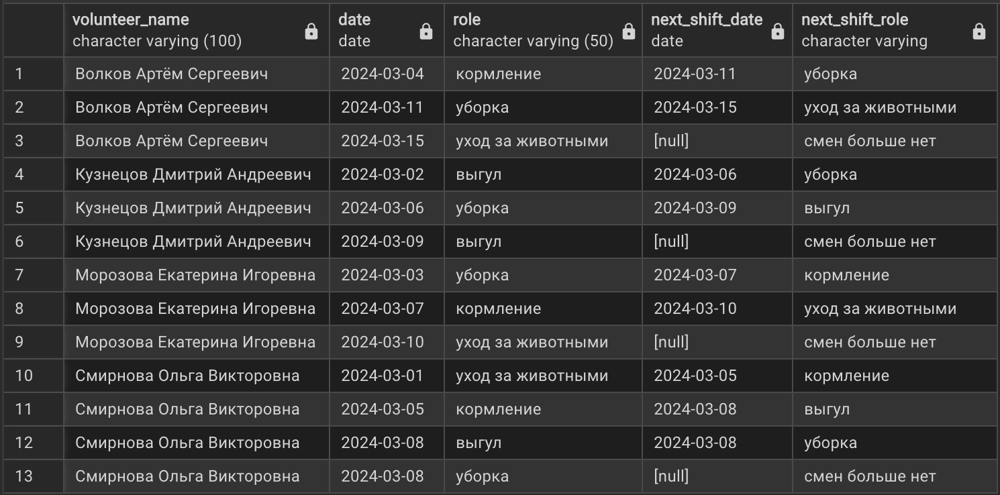

### Запрос 10.3
`first_value`: для каждого животного вывести самого давнего жителя его приюта

```sql
select
    name,
    shelter_id,
    arrival_date,
    first_value(name) over (
        partition by shelter_id
        order by arrival_date, animal_id
    ) as oldest_resident
from animals
order by shelter_id, arrival_date, animal_id;
```
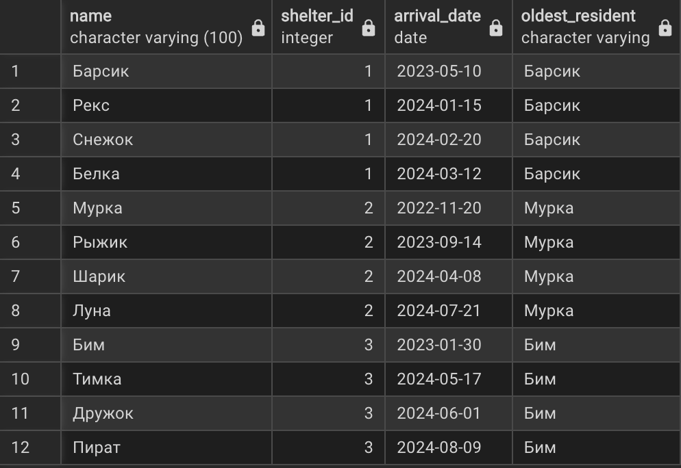

### Запрос 10.4
`last_value`: для каждого животного вывести самого недавно поступившего жителя его приюта. Окно по умолчанию заканчивается на текущей строке, из-за этого `last_value` просто возвращал бы текущее животное, поэтому конец окна нужно явно сдвинуть на последнюю строку партиции

```sql
select
    name,
    shelter_id,
    arrival_date,
    last_value(name) over (
        partition by shelter_id
        order by arrival_date, animal_id
        rows between unbounded preceding and unbounded following
    ) as newest_resident
from animals
order by shelter_id, arrival_date, animal_id;
```
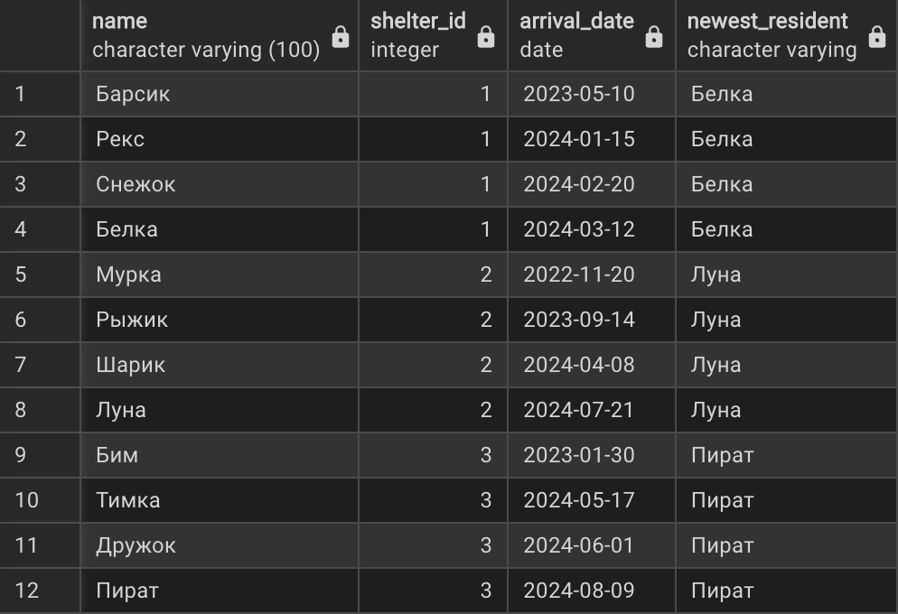
