# HW7: Транзакции

Эксперименты выполнены на базе приюта из HW6 (тема 9) по порядку, сверху вниз. В опытах с двумя транзакциями использовались две консоли, каждая из которых это отдельная сессия: `T1` (консоль 1) и `T2` (консоль 2). Шаги в таких блоках пронумерованы в том порядке, в котором они выполнялись.

# Блок 1: базовые операции с транзакциями

## 1. BEGIN ... COMMIT

### Запрос 1.1
Добавить заявку на усыновление животного и изменить его статус. Обе операции выполняются в одной транзакции, поэтому фиксируются вместе

```sql
begin;

-- Добавляем заявку на усыновление животного
insert into adoption_applications (animal_id, visitor_id, application_date, status)
values (5, 6, current_date, 'pending');

-- Меняем статус животного
update animals
set status = 'reserved'
where animal_id = 5;

-- Фиксируем обе операции
commit;

-- Проверяем результат
select animal_id, name, status
from animals
where animal_id = 5;

select application_id, animal_id, visitor_id, status
from adoption_applications
where animal_id = 5
order by application_id desc
limit 1;
```
**Результат:** после `commit` изменения видны обе: у животного Снежок статус `reserved`, а в таблице заявок появилась новая заявка (`application_id = 13`) со статусом `pending`
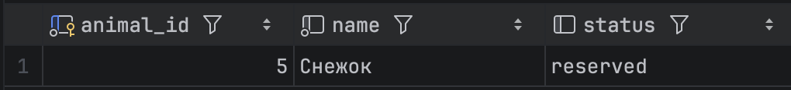
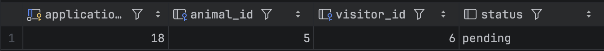

### Запрос 1.2
Зарегистрировать нового посетителя и сразу переоформить на него существующую заявку. Новая строка добавляется в `visitors`, а связанная строка обновляется в `adoption_applications`

```sql
begin;

-- Добавляем нового посетителя
insert into visitors (name, phone, email, registration_year)
values ('Новикова Елена Андреевна', '+79990001122', 'novikova@mail.ru', 2026);

-- Переоформляем заявку 8 на нового посетителя (его id берем подзапросом по email)
update adoption_applications
set visitor_id = (select visitor_id from visitors where email = 'novikova@mail.ru')
where application_id = 8;

commit;

-- Проверяем результат
select application_id, animal_id, visitor_id, status
from adoption_applications
where application_id = 8;

select visitor_id, name, email
from visitors
order by visitor_id desc
limit 1;
```
**Результат:** посетитель добавлен (`visitor_id = 7`), и заявка 8 теперь указывает на него. Обе операции зафиксировались вместе
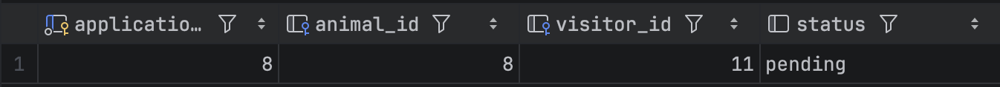
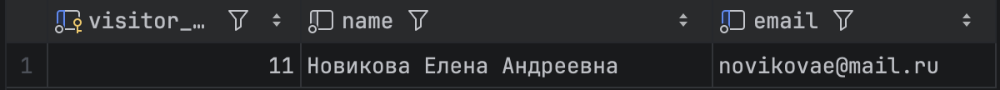

## 2. ROLLBACK

### Запрос 2.1
Тот же сценарий, что в 1.1 (заявка + смена статуса), но вместо `commit` делаем `rollback`. Внутри транзакции изменения видны, после отката должны исчезнуть

```sql
begin;

-- Добавляем заявку на усыновление животного
insert into adoption_applications (animal_id, visitor_id, application_date, status)
values (6, 3, current_date, 'pending');

-- Меняем статус животного
update animals
set status = 'reserved'
where animal_id = 6;

-- Внутри транзакции изменения уже видны
select animal_id, name, status
from animals
where animal_id = 6;

select count(*) from adoption_applications;

-- Отменяем все изменения
rollback;

-- Проверяем, что после отката ничего не изменилось
select animal_id, name, status
from animals
where animal_id = 6;

select count(*), max(application_id) from adoption_applications;

-- Последовательность (serial) при откате не откатывается
select last_value from adoption_applications_application_id_seq;
```
**Результат:** внутри транзакции у Белки был статус `reserved` и заявок было 14. После `rollback` статус вернулся к `available`, заявок снова 13. При этом `last_value` у последовательности равен 14, хотя максимальный `application_id` в таблице 13: номер 14 был выдан и пропал вместе с откатом
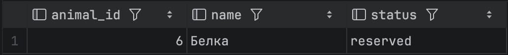
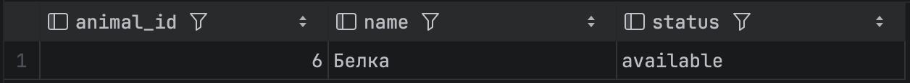
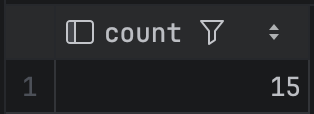
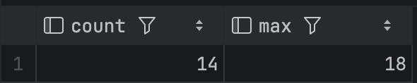
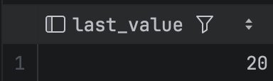

### Запрос 2.2
Тот же сценарий, что в 1.2 (посетитель + переоформление заявки), но с `rollback`

```sql
begin;

-- Добавляем нового посетителя
insert into visitors (name, phone, email, registration_year)
values ('Громова Ольга Ивановна', '+79990003344', 'gromova@mail.ru', 2026);

-- Переоформляем заявку 10 на нового посетителя
update adoption_applications
set visitor_id = (select visitor_id from visitors where email = 'gromova@mail.ru')
where application_id = 10;

-- Внутри транзакции заявка уже указывает на нового посетителя
select application_id, visitor_id
from adoption_applications
where application_id = 10;

rollback;

-- Проверяем результат
select application_id, visitor_id
from adoption_applications
where application_id = 10;

select count(*) from visitors where email = 'gromova@mail.ru';
```
**Результат:** внутри транзакции у заявки 10 был `visitor_id = 8` (новый посетитель), после `rollback` вернулся прежний `visitor_id = 2`, а посетителя с такой почтой в таблице нет (`count = 0`)
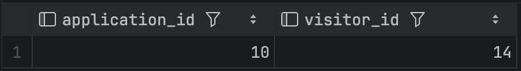
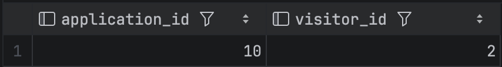

## 3. Ошибка внутри транзакции

### Запрос 3.1
Добавить в транзакцию деление на ноль. Первые две операции корректные, но после ошибки PostgreSQL помечает всю транзакцию как прерванную

```sql
begin;

-- Корректные операции
insert into adoption_applications (animal_id, visitor_id, application_date, status)
values (6, 3, current_date, 'pending');

update animals
set status = 'reserved'
where animal_id = 6;

-- Ошибка: деление на ноль
select 1 / 0;

-- Любая следующая команда уже не выполнится
select animal_id, status from animals where animal_id = 6;

-- Несмотря на commit, PostgreSQL выполнит rollback
commit;

-- Проверяем результат
select animal_id, name, status
from animals
where animal_id = 6;

select count(*)
from adoption_applications
where animal_id = 6 and visitor_id = 3;
```
**Результат:** `select 1 / 0` завершился ошибкой `division by zero`. Следующий запрос вернул `current transaction is aborted, commands ignored until end of transaction block`, а `commit` ответил `ROLLBACK`. Статус Белки остался `available`, заявки в таблице нет (`count = 0`). То есть откатились и корректные операции, выполненные до ошибки


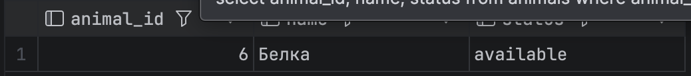


### Запрос 3.2
Ошибка из-за нарушения ограничения: вставляем посетителя с уже существующей почтой (`email` в `visitors` unique)

```sql
begin;

-- Корректная операция
update animals
set status = 'reserved'
where animal_id = 9;

-- Ошибка: почта petrov@gmail.com уже есть у другого посетителя
insert into visitors (name, phone, email, registration_year)
values ('Дубликатов Пётр', '+79990005566', 'petrov@gmail.com', 2026);

-- Транзакция уже прервана, эта команда не выполнится
insert into adoption_applications (animal_id, visitor_id, application_date, status)
values (9, 3, current_date, 'pending');

rollback;

-- Проверяем результат
select animal_id, name, status
from animals
where animal_id = 9;

select count(*)
from adoption_applications
where animal_id = 9 and visitor_id = 3;
```
**Результат:** вставка упала с `duplicate key value violates unique constraint "visitors_email_key"`, следующая команда была проигнорирована из-за прерванной транзакции. После `rollback` статус Луны остался `available`, заявки нет. Обновление статуса, сделанное до ошибки, тоже откатилось

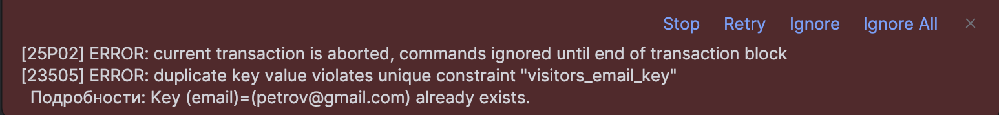
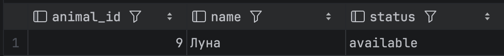


# Блок 2: уровни изоляции

## 4. Грязное чтение: READ UNCOMMITTED и READ COMMITTED

### Запрос 4.1
`READ UNCOMMITTED`: T1 меняет данные и не фиксирует, T2 пытается их прочитать

```sql
-- шаг 1 | T1: меняем статус животного, но не фиксируем
begin;
update animals set status = 'reserved' where animal_id = 7;

-- шаг 2 | T1: внутри своей транзакции изменение видно
select animal_id, name, status from animals where animal_id = 7;

-- шаг 3 | T2: открываем транзакцию с самым низким уровнем изоляции
begin isolation level read uncommitted;
show transaction_isolation;

-- шаг 4 | T2: пробуем прочитать незафиксированные данные
select animal_id, name, status from animals where animal_id = 7;

-- шаг 5 | T1: отменяем изменение
rollback;

-- шаг 6 | T2: читаем еще раз и завершаем транзакцию
select animal_id, name, status from animals where animal_id = 7;
commit;
```
**Результат:** `show transaction_isolation` показал `read uncommitted`, но T2 на шаге 4 всё равно увидела старый статус `available`, а не `reserved`. Грязного чтения нет: в PostgreSQL `read uncommitted` работает как `read committed`


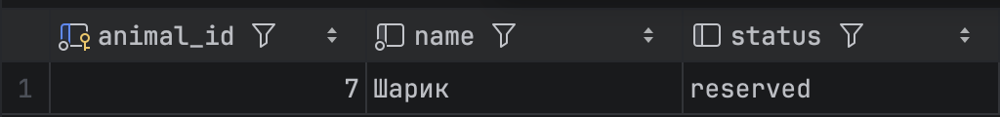
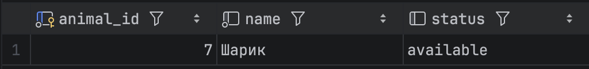

### Запрос 4.2
`READ COMMITTED` (уровень по умолчанию): T1 меняет статус заявки без `commit`, T2 читает, затем T1 фиксирует

```sql
-- шаг 1 | T1: меняем статус заявки, но не фиксируем
begin;
update adoption_applications set status = 'approved' where application_id = 8;

-- шаг 2 | T1: внутри своей транзакции видно новое значение
select application_id, status from adoption_applications where application_id = 8;

-- шаг 3 | T2: читаем заявку на уровне read committed
begin isolation level read committed;
select application_id, status from adoption_applications where application_id = 8;

-- шаг 4 | T1: фиксируем изменение
commit;

-- шаг 5 | T2: читаем снова и завершаем транзакцию
select application_id, status from adoption_applications where application_id = 8;
commit;
```
**Результат:** пока T1 не сделала `commit`, T2 видела `pending`. После `commit` T2 увидела `approved`. Это уже не грязное чтение: данные зафиксированы
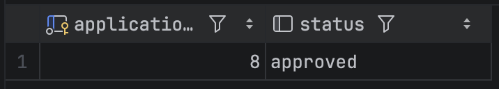
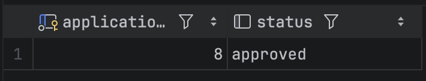
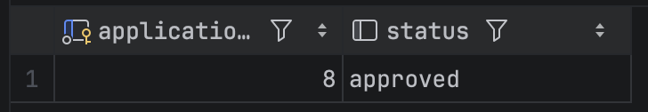

## 5. READ COMMITTED: неповторяющееся и фантомное чтение

### Запрос 5.1
Неповторяющееся чтение: T1 дважды читает одну строку, между чтениями T2 делает `update` и `commit`

```sql
-- шаг 1 | T1: первое чтение
begin isolation level read committed;
select animal_id, name, status from animals where animal_id = 10;

-- шаг 2 | T2: меняет эту же строку и фиксирует
begin;
update animals set status = 'adopted' where animal_id = 10;
commit;

-- шаг 3 | T1: второе чтение той же строки в той же транзакции
select animal_id, name, status from animals where animal_id = 10;
commit;
```
**Результат:** в рамках одной транзакции T1 один и тот же запрос вернул разные значения: сначала `available`, потом `adopted`. Это неповторяющееся чтение
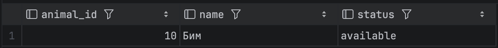
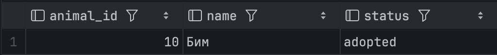

### Запрос 5.2
Фантомное чтение: T1 дважды выбирает заявки по условию, между выборками T2 добавляет подходящую строку

```sql
-- шаг 1 | T1: первая выборка заявок в статусе pending
begin isolation level read committed;
select count(*) from adoption_applications where status = 'pending';
select application_id, animal_id, status
from adoption_applications
where status = 'pending'
order by application_id;

-- шаг 2 | T2: добавляет новую подходящую заявку и фиксирует
begin;
insert into adoption_applications (animal_id, visitor_id, application_date, status)
values (9, 3, current_date, 'pending');
commit;

-- шаг 3 | T1: повторная выборка с тем же условием
select count(*) from adoption_applications where status = 'pending';
select application_id, animal_id, status
from adoption_applications
where status = 'pending'
order by application_id;
commit;
```
**Результат:** при первой выборке было 5 заявок `pending`, при повторной 6: в результате появилась новая строка (`application_id = 16`). Это фантомное чтение. Номер 16, а не 14, потому что 14 и 15 были израсходованы откатами из запросов 2.1 и 3.1
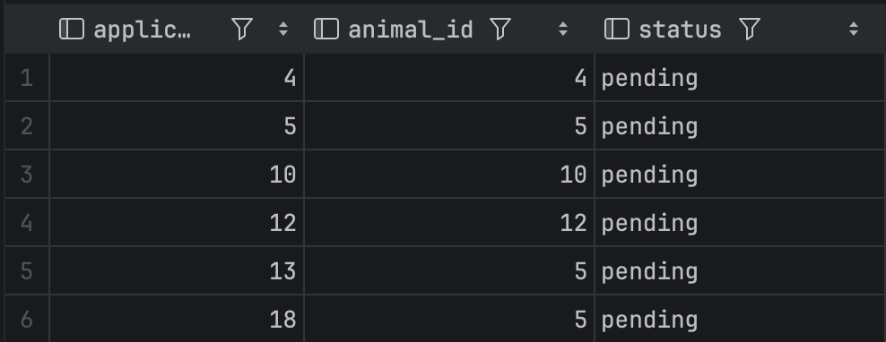
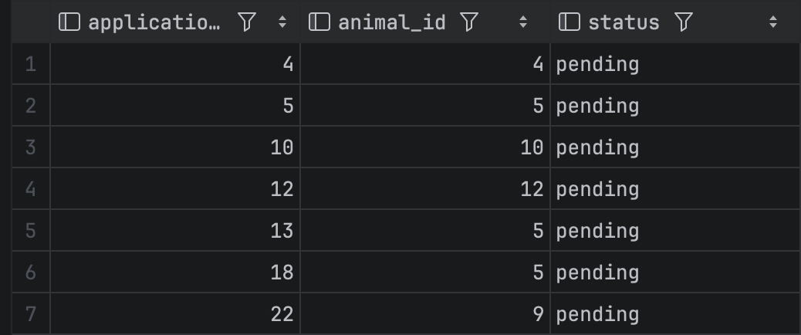
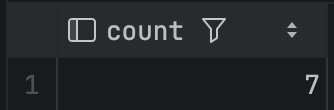
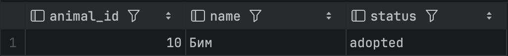
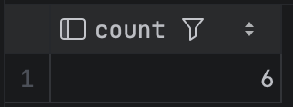

## 6. REPEATABLE READ

### Запрос 6.1
T1 работает со снимком данных и не видит изменений T2, пока не завершится. Заодно проверяем, что T1 не может изменить строку, которую после снимка поменяла T2

```sql
-- шаг 1 | T1: начинаем транзакцию, снимок фиксируется при первом запросе
begin isolation level repeatable read;
select volunteer_id, name, phone from volunteers where volunteer_id = 2;

-- шаг 2 | T2: меняет телефон волонтера и фиксирует
begin;
update volunteers set phone = '+79002223344' where volunteer_id = 2;
commit;

-- шаг 3 | T1: читаем снова, это тот же снимок
select volunteer_id, name, phone from volunteers where volunteer_id = 2;

-- шаг 4 | T1: пробуем изменить строку, которую уже поменяла T2
update volunteers set phone = '+79005556677' where volunteer_id = 2;

-- шаг 5 | T1: после ошибки транзакцию можно только откатить
rollback;

-- шаг 6 | T1: новая транзакция (новый снимок)
select volunteer_id, name, phone from volunteers where volunteer_id = 2;
```
**Результат:** на шаге 3 T1 по-прежнему видит старый телефон `+79992223344`, хотя T2 уже зафиксировала новый. На шаге 4 `update` завершился ошибкой `could not serialize access due to concurrent update`: строка изменилась после снимка T1. После `rollback` новый запрос видит актуальный телефон `+79002223344`
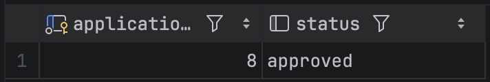
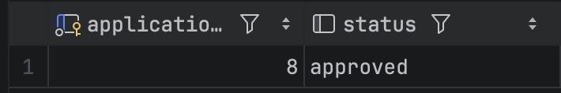
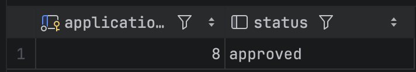

### Запрос 6.2
Фантомное чтение на `REPEATABLE READ`: T2 добавляет строку, подходящую под выборку T1

```sql
-- шаг 1 | T1: считаем смены волонтера 4
begin isolation level repeatable read;
select count(*) from shifts where volunteer_id = 4;

-- шаг 2 | T2: добавляет новую смену этому волонтеру и фиксирует
begin;
insert into shifts (volunteer_id, date, start_time, end_time, role)
values (4, '2024-03-12', '10:00', '14:00', 'выгул');
commit;

-- шаг 3 | T1: повторная выборка
select count(*) from shifts where volunteer_id = 4;
select shifts_id, date, role from shifts where volunteer_id = 4 order by shifts_id;

-- шаг 4 | T1: завершаем транзакцию и читаем в новой
commit;
select count(*) from shifts where volunteer_id = 4;
```
**Результат:** до и после вставки T2 внутри T1 одно и то же количество смен (3), новая смена не появилась. В отличие от запроса 5.2, фантомного чтения нет: в PostgreSQL снимок защищает и от него. После `commit` новая транзакция уже видит 4 смены
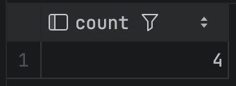

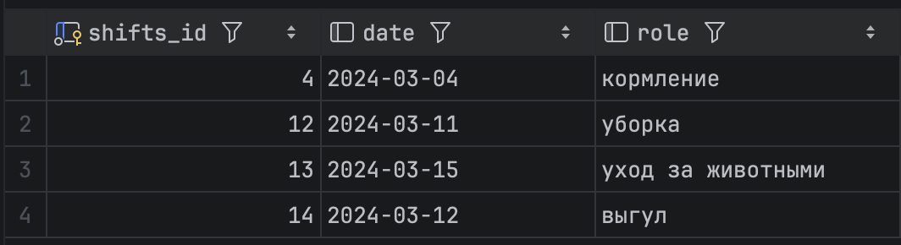


## 7. SERIALIZABLE

### Запрос 7.1
Конфликт двух транзакций, которые вставляют одинаковые данные. Правило приюта: на одно животное не должно быть больше одной заявки в статусе `pending`. Каждая транзакция сначала проверяет, что такой заявки нет, и добавляет свою

```sql
-- шаг 1 | T1 и T2: открываем транзакции
begin isolation level serializable;   -- T1
begin isolation level serializable;   -- T2

-- шаг 2 | T1 и T2: обе проверяют, есть ли заявка pending на животное 11
select count(*) from adoption_applications
where animal_id = 11 and status = 'pending';

-- шаг 3 | T1: добавляет заявку от посетителя 3
insert into adoption_applications (animal_id, visitor_id, application_date, status)
values (11, 3, current_date, 'pending');

-- шаг 4 | T2: добавляет заявку от посетителя 5
insert into adoption_applications (animal_id, visitor_id, application_date, status)
values (11, 5, current_date, 'pending');

-- шаг 5 | T1: фиксирует
commit;

-- шаг 6 | T2: пробует зафиксировать
commit;

-- шаг 7 | T2: откатываем и повторяем транзакцию целиком
rollback;
begin isolation level serializable;
select count(*) from adoption_applications
where animal_id = 11 and status = 'pending';
commit;
```
**Результат:** обе транзакции на шаге 2 получили `0` и обе вставили заявку. `commit` у T1 прошёл, а `commit` у T2 завершился ошибкой `could not serialize access due to read/write dependencies among transactions` с подсказкой `The transaction might succeed if retried`. При повторе T2 уже видит `1` заявку и новую вставлять не должна. Для сравнения, на `repeatable read` в таком же сценарии обе вставки прошли, и у животного оказалось две заявки `pending`
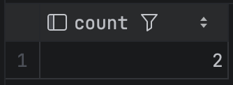
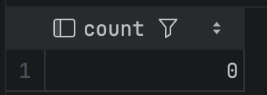
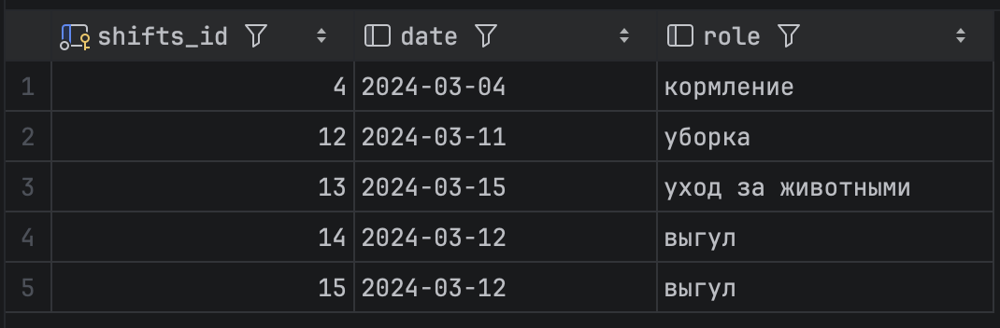
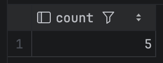

### Запрос 7.2
Конфликт при изменении одной строки: ловим ошибку `could not serialize access due to concurrent update` и повторяем транзакцию

```sql
-- шаг 1 | T1 и T2: открываем транзакции и читаем статус животного 4
begin isolation level serializable;   -- T1
begin isolation level serializable;   -- T2
select animal_id, name, status from animals where animal_id = 4;

-- шаг 2 | T1: меняет статус
update animals set status = 'reserved' where animal_id = 4;

-- шаг 3 | T2: пытается поменять ту же строку, команда зависает в ожидании T1
update animals set status = 'adopted' where animal_id = 4;

-- шаг 4 | T1: фиксирует, T2 сразу получает ошибку
commit;

-- шаг 5 | T2: откатываем и повторяем транзакцию
rollback;
begin isolation level serializable;
select animal_id, name, status from animals where animal_id = 4;
update animals set status = 'adopted' where animal_id = 4;
commit;

-- Проверяем итог
select animal_id, name, status from animals where animal_id = 4;
```
**Результат:** на шаге 3 `update` в T2 повис и ждал, пока T1 не зафиксируется. После `commit` T1 он завершился ошибкой `could not serialize access due to concurrent update`. После повтора T2 в новой транзакции увидела `reserved` и успешно поставила `adopted`. Итоговый статус Дружка `adopted`
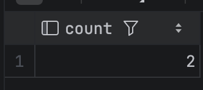
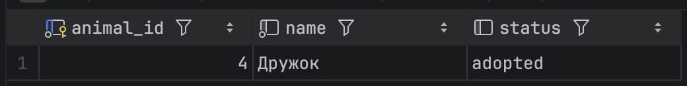
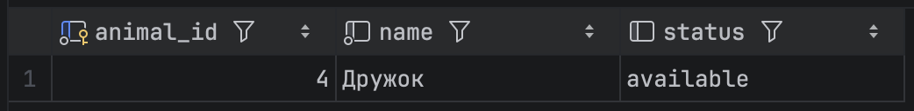
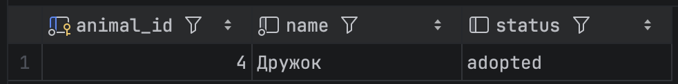

# Блок 3: SAVEPOINT

## 8. Точки сохранения

### Запрос 8.1
Транзакция с несколькими изменениями и одной точкой сохранения. Откатываем только то, что сделано после неё

```sql
begin;

-- Изменение 1: регистрируем нового посетителя
insert into visitors (name, phone, email, registration_year)
values ('Алексеева Дарья Олеговна', '+79990007788', 'alekseeva@mail.ru', 2026);

-- Точка сохранения после добавления посетителя
savepoint after_visitor;

-- Изменение 2: заявка от этого посетителя
insert into adoption_applications (animal_id, visitor_id, application_date, status)
values (9, (select visitor_id from visitors where email = 'alekseeva@mail.ru'), current_date, 'pending');

-- Изменение 3: бронируем животное
update animals
set status = 'reserved'
where animal_id = 9;

-- До отката: заявка есть, статус reserved
select animal_id, status from animals where animal_id = 9;
select count(*) from adoption_applications
where visitor_id = (select visitor_id from visitors where email = 'alekseeva@mail.ru');

-- Откатываемся к точке сохранения
rollback to savepoint after_visitor;

-- После отката: заявки и брони нет, а посетитель на месте
select animal_id, status from animals where animal_id = 9;
select count(*) from adoption_applications
where visitor_id = (select visitor_id from visitors where email = 'alekseeva@mail.ru');
select visitor_id, name from visitors where email = 'alekseeva@mail.ru';

-- Фиксируем то, что осталось
commit;

-- Проверяем после commit
select visitor_id, name from visitors where email = 'alekseeva@mail.ru';
select animal_id, status from animals where animal_id = 9;
```
**Результат:** до отката у животного был статус `reserved` и одна заявка. После `rollback to savepoint` статус вернулся к `available`, заявки не стало, но посетитель (добавленный до точки сохранения) остался. После `commit` в базе сохранился только он
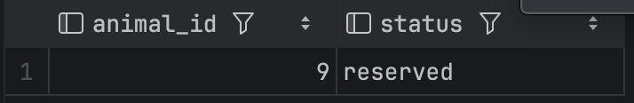
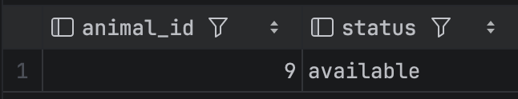
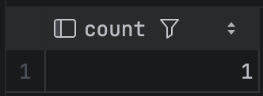
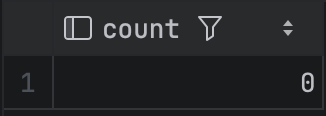
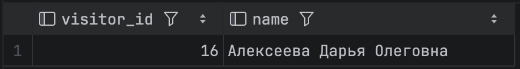
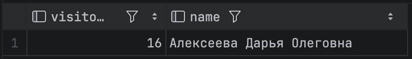
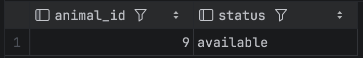

### Запрос 8.2
Две точки сохранения: возвращаемся сначала ко второй, потом к первой

```sql
begin;

-- Изменение 1: новая смена волонтера 1
insert into shifts (volunteer_id, date, start_time, end_time, role)
values (1, '2024-03-13', '09:00', '12:00', 'кормление');

savepoint sp1;

-- Изменение 2: меняем телефон волонтера
update volunteers
set phone = '+79000001111'
where volunteer_id = 1;

savepoint sp2;

-- Изменение 3: меняем роль в созданной смене
update shifts
set role = 'уборка'
where volunteer_id = 1 and date = '2024-03-13';

-- Состояние перед откатами
select phone from volunteers where volunteer_id = 1;
select role from shifts where volunteer_id = 1 and date = '2024-03-13';

-- Откат ко второй точке: отменяется только изменение 3
rollback to savepoint sp2;
select role from shifts where volunteer_id = 1 and date = '2024-03-13';
select phone from volunteers where volunteer_id = 1;

-- Откат к первой точке: отменяется и изменение 2
rollback to savepoint sp1;
select phone from volunteers where volunteer_id = 1;
select count(*) from shifts where volunteer_id = 1 and date = '2024-03-13';

commit;
```
**Результат:** после отката к `sp2` роль смены вернулась к `кормление`, а телефон остался новым `+79000001111`. После отката к `sp1` телефон тоже вернулся к прежнему `+79991112233`, а смена (добавленная до `sp1`) осталась (`count = 1`) и сохранилась после `commit`
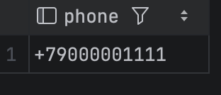
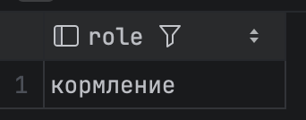
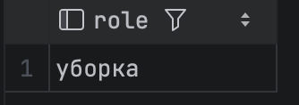
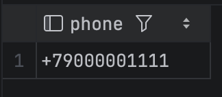


# Выводы

## Уровни изоляции

| Уровень | Грязное чтение | Неповторяющееся чтение | Фантомное чтение | Что увидели на своих данных |
|---|---|---|---|---|
| READ UNCOMMITTED | нет | да | да | T2 не увидела незафиксированный статус (4.1). В PostgreSQL ведёт себя как READ COMMITTED |
| READ COMMITTED | нет | да (5.1) | да (5.2) | Каждый `select` видит все изменения, зафиксированные к этому моменту. В 4.2 данные T1 стали видны только после `commit` |
| REPEATABLE READ | нет | нет (6.1) | нет (6.2) | T1 работает со снимком, на повторный `select` изменения T2 не влияют. Изменить строку, которую после снимка поменяла другая транзакция, нельзя: ошибка `concurrent update` |
| SERIALIZABLE | нет | нет | нет | Две транзакции, каждая из которых по отдельности корректна, вместе нарушили бы правило «одна заявка pending на животное». Вторую PostgreSQL отменил ошибкой serialization failure (7.1) |

- Чем выше уровень, тем больше аномалий исключено, но тем чаще возможны ошибки сериализации. Их надо ловить в приложении и повторять транзакцию (7.1, 7.2): после повтора транзакция видит свежие данные и принимает уже другое решение
- `READ UNCOMMITTED` в PostgreSQL отдельного поведения не имеет, грязное чтение невозможно ни на одном уровне
- Фантомное чтение на `REPEATABLE READ` в PostgreSQL не возникает (6.2), хотя по стандарту SQL на этом уровне оно допускалось
- Аномалию, которую не ловит даже `REPEATABLE READ` (две вставки по правилу «одна заявка pending на животное»), закрывает только `SERIALIZABLE`

## ROLLBACK и ошибки

- `rollback` отменяет все операции транзакции целиком: и `insert`, и `update`, даже если они были корректны (2.1, 2.2). Внутри транзакции изменения видны только ей самой, поэтому до `commit` другие сессии их не видят (4.1, 4.2)
- Любая ошибка (деление на ноль в 3.1, нарушение `unique` в 3.2) переводит транзакцию в прерванное состояние: следующие команды игнорируются, а `commit` фактически превращается в `rollback`. Корректные операции, сделанные до ошибки, тоже откатываются, то есть транзакция атомарна
- Значения `serial` при откате не возвращаются: после запросов 2.1 и 3.1 в `application_id` образовался пропуск (14 и 15), и новая заявка в 5.2 получила номер 16. Для первичных ключей это нормально, главное, что номера не повторяются

## SAVEPOINT

- Точка сохранения позволяет откатить часть транзакции, не теряя всю работу. Изменения до `savepoint` остаются (посетитель в 8.1, смена в 8.2), а изменения после него отменяются
- `rollback to savepoint` не завершает транзакцию, после него можно продолжать работу и в конце сделать `commit`
- При откате к `sp1` точка `sp2`, созданная позже, удаляется: повторный `rollback to savepoint sp2` завершился бы ошибкой `savepoint "sp2" does not exist`. Поэтому откатываться к нескольким точкам нужно в порядке от поздней к ранней (8.2). Сама `sp1` после отката остаётся и ей можно пользоваться дальше
